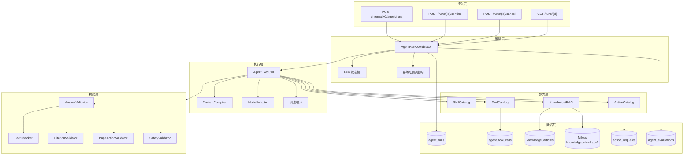
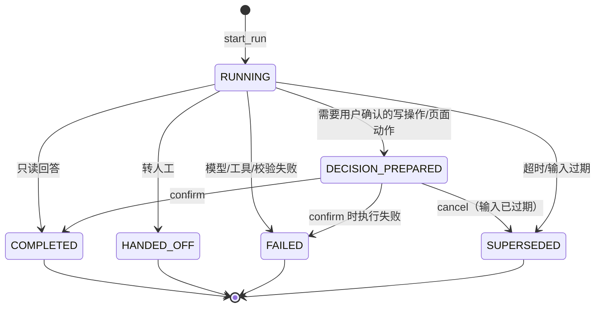
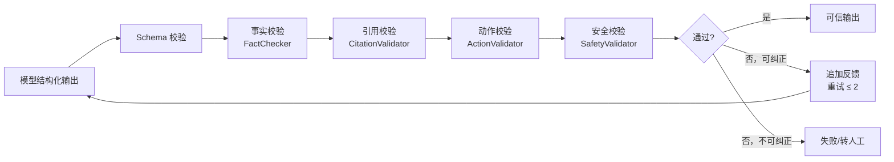

# 学习机智能客服 — AI 服务 PRD

| 项 | 内容 |
|---|---|
| 文档版本 | v0.2（已确认） |
| 文档状态 | **方案已确认，进入骨架搭建** |
| 编写日期 | 2026-10-26 |
| 确认日期 | 2026-10-26 |
| 适用项目 | `PRD/customer_ai_edu` |
| 配套文档 | [`customer_service_edu_PRD.md`](./customer_service_edu_PRD.md) |
| 参考代码 | `C:\data\python_data\ai-service`、`C:\data\python_data\customer-service` |
| 阅读约定 | 【假设】= 尚未确认、按行业常规先假定；【待确认】= 需要你拍板；【建议】= 我的推荐方案 |

> 本文于 **2026-10-26 确认**。§0 是已确认结论，优先于下文；下文保留完整能力规划，作为 Phase 2/3 Roadmap。

---

## 0. 已确认方案（v0.2）

### 0.1 已确认决策

| ID | 决策 | 确认结果 |
|---|---|---|
| A-01 | MVP 范围 | **售后**：订单物流 + 硬件故障 + 保修维修 + 政策 + 投诉转人工 |
| A-02 | 业务对接 | 直接对接；暂无真实系统，先用 PostgreSQL 测试表 + Mock/ACL |
| A-03 | 多租户 | **MVP 即多租户**（HQ + DEALER）；Run/工具/知识全部带 `tenant_id` |
| A-05 | 写操作 | 取消未发货订单 + 报修建单；其余只读 |
| A-06 | 多模态 | 文本 + 图片 |
| A-09 | 模型 | 多模型路由；七牛云 OpenAI 兼容接口 |
| A-10 | 知识库 | PostgreSQL 元数据 + Milvus 向量/BM25；embedding = `bge-m3`（1024 维） |
| B01–B30 | 技术改造 | 全部采纳 |

### 0.2 MVP 技能范围

| 阶段 | 技能 |
|---|---|
| **MVP** | `order-logistics`、`hardware-diagnosis`、`warranty-repair`、`policy-compliance`、`complaint-risk` |
| Phase 2 | `device-activation`、`course-membership`、`learning-feature` |
| Phase 3 | `product-advisor` |

### 0.3 关键调整

- **RAG 不再使用 pgvector**：文章/版本/权限在 PostgreSQL，切片向量与 BM25 在 Milvus collection `edu_cs_knowledge_v1`。
- 模型：主推理 `deepseek/deepseek-v4-pro`，快速分类 `qwen/qwen3.7-flash`，视觉 `qwen2.5-vl-72b-instruct`；详见 [`../config.md`](../config.md)。
- Run 增加 `tenant_id`、`request_id`、心跳；工具调用与知识检索强制租户过滤。
- 评测集先覆盖 5 个 MVP 技能，售前/课程/学习用例 Phase 2 补充。

---

## 1. 背景与定位

### 1.1 AI 在学习机客服中的定位

AI 不是“通用聊天机器人”，而是 **有边界的业务助手**：

1. **能查**：订单、物流、设备、保修、课程/权益、维修进度、门店、知识。
2. **能答**：基于成功工具结果与知识引用回答，不猜、不编、不承诺未授权操作。
3. **能引导**：告诉用户下一步去哪里、点哪里、准备什么材料。
4. **能判断**：什么时候该转人工、转哪个技能组、优先级多高。
5. **不能做**：不能直接扣款/退款、不能绕过保修规则、不能查看无关用户数据、不能对未成年人做高风险承诺。

### 1.2 参考项目可复用的 AI 资产

| 能力 | 代码位置 | 复用结论 |
|---|---|---|
| LangChain `create_agent` + 结构化输出 | `agent/factory.py` | **保留** |
| 技能目录与动态提示词 | `harness/skills/*`、`dynamic_prompt.py` | **保留**，替换技能 |
| 工具目录与统一执行器 | `harness/tools/catalog.py`、`executor.py` | **保留**，替换工具 |
| 工具结果统一契约 | `harness/tools/output.py` | **保留**，扩展教育数据模型 |
| 事实校验 + 纠错重试 | `harness/validator/*`、`rules/*` | **保留**，扩展实体与规则 |
| 页面动作白名单 | `rules/action.py`、`validator/action.py` | **保留**，替换为教育页面 |
| 两阶段 Run 状态机 | `harness/run/*`、`app/services/run.py` | **保留**，修复归属/幂等 |
| 运行与工具审计 | `models/models.py`、`app/services/admin.py` | **保留**，扩展指标 |
| 上下文编译与裁剪 | `harness/run/context.py` | **保留**，补充摘要/多模态 |
| 模型适配 | `agent/llm/adapter.py` | **保留**，增加路由/降级 |

### 1.3 关键差距

| # | 差距 | 现状 | 目标 |
|---|---|---|---|
| G1 | 领域是电商 | 商品/订单/物流/售后 4 类技能 | 学习机 8+ 类技能 |
| G2 | 知识是硬编码 | `KnowledgeQueryService` 返回 3 条固定数据 | RAG + 版本化 + 引用 |
| G3 | 业务系统直连 | `EcommerceClient` 写死电商接口 | `EduBusinessClient` + ACL 适配 |
| G4 | 输出契约太薄 | 只有 reply_type/content/handoff/page_action | 增加 intent/confidence/citations/risk/slots/action |
| G5 | 无多模态 | 只处理文本/对象 | 图片/语音/视频（至少图片） |
| G6 | 无未成年人/内容安全 | 无 | 输入/输出双向安全 + 强制转人工 |
| G7 | 无评测 | 无 golden set | 意图/答案/引用/转人工/动作安全评测 |
| G8 | Run 归属/幂等缺失 | confirm/cancel 不校验 | 状态机 + 归属 + request_id |
| G9 | 无成本/延迟治理 | 单一模型、无预算 | 模型路由、token 预算、缓存 |
| G10 | 启动即失败 | `app.py` 引用未定义 `operations` | Phase 0 修复 |

---

## 2. 目标与指标

### 2.1 产品目标

1. **AI 独立解决售后常见问题（MVP）**：订单物流、硬件故障、保修维修、政策咨询、投诉前置分流；售前/课程/学习功能为 Phase 2。
2. **可靠回答**：所有业务事实有工具依据；所有政策/产品说明有知识引用。
3. **安全转人工**：该转的必须转（投诉、未成年人、支付、低置信、连续失败），不该转的不要推给人工。
4. **可运营**：技能、工具、知识、提示词、评测集都能版本化迭代。
5. **可控成本**：单次会话 token/费用可观测、可预算、可降级。

### 2.2 指标（建议目标，需基线校准）

| 指标 | 定义 | 建议目标 |
|---|---|---|
| MET-AI-01 意图识别准确率 | 8 类主意图 + 子意图 | ≥ 92% |
| MET-AI-02 答案正确率 | 人工评测“事实正确且完整” | ≥ 90% |
| MET-AI-03 引用准确率 | 政策/产品说明有正确引用 | ≥ 95% |
| MET-AI-04 无依据事实率 | 抽检中出现无工具/知识依据的事实 | ≤ 2% |
| MET-AI-05 转人工准确率 | 应转的转了 | ≥ 95% |
| MET-AI-06 转人工精确率 | 转了的确实需要人工 | ≥ 80% |
| MET-AI-07 动作安全率 | 未授权/未确认动作 | 0 起 P0 |
| MET-AI-08 首响 P95 | Run 开始 → 首个结果 | ≤ 5 s |
| MET-AI-09 工具成功率 | 成功工具调用 / 总调用 | ≥ 98%（排除业务失败） |
| MET-AI-10 单会话成本 | 平均 token/费用 | 预算内 |
| MET-AI-11 纠错成功率 | 首次校验失败后二次通过 | ≥ 70% |
| MET-AI-12 知识召回率 | 评测集 recall@5 | ≥ 90% |

### 2.3 非目标

- 不做通用百科/闲聊；非学习机相关问题应 `DECLINE` 或转人工。
- 不做医疗诊断、投资建议、法律意见。
- 不直接执行支付/退款/扣款。
- 不替代人工做保修责任最终判定（可给建议，最终由人工/维修系统确认）。
- 不做模型训练/微调（本期以提示词 + RAG + 工具为主）。

---

## 3. 用户、场景与意图体系

### 3.1 AI 服务的调用方

| 调用方 | 说明 |
|---|---|
| customer-service AI Worker | 主要调用方；携带用户 Token + 内部 Token |
| 管理后台 | 查询 Run、工具调用、bad case |
| 评测平台 | 离线批量调用 |
| 人工坐席助手（P2） | 坐席侧建议回复/摘要 |

### 3.2 意图体系

| 一级意图 | 二级意图（示例） | 主要技能 | 默认处理 |
|---|---|---|---|
| `PRE_SALES` | 选型、型号对比、价格、活动、适配年级/教材 | product-advisor | AI |
| `ORDER` | 订单状态、发货、物流、改址、取消、发票 | order-logistics | AI / 受控写 |
| `DEVICE` | 激活、绑定、解绑、换绑、SN 查询 | device-activation | AI / 转人工 |
| `COURSE` | 课程开通、会员到期、续费、退款、内容打不开 | course-membership | AI / 转人工 |
| `LEARNING` | 同步课、AI 错题、口语评测、家长管控、学习报告 | learning-feature | AI（家长校验） |
| `HARDWARE` | 不开机、黑屏、充电、触控、网络、声音 | hardware-diagnosis | AI 故障树 |
| `REPAIR` | 保修查询、报修、寄修、到店、维修进度、报价 | warranty-repair | AI / 维修单 |
| `POLICY` | 退换货、保修政策、隐私、发票规则 | policy-compliance | AI + 引用 |
| `COMPLAINT` | 投诉、情绪激动、舆情、威胁曝光 | complaint-risk | **立即转人工** |
| `RISK` | 未成年人充值、账号被盗、隐私删除、支付争议 | complaint-risk | **立即转人工 + 风控** |
| `OTHER` | 非业务、闲聊、无法识别 | — | DECLINE / CLARIFY |

### 3.3 典型场景与 AI 行为

| 场景 | 用户说 | AI 应做 | 不应做 |
|---|---|---|---|
| 售前选型 | “三年级，主要想练英语，预算 3000” | 追问教材版本/使用习惯；推荐 2–3 款并对比；给页面入口 | 编造未上架型号/价格 |
| 订单物流 | “上周买的，怎么还没到” | 查订单列表 → 确认订单 → 查物流 → 给最新节点 | 猜测快递位置 |
| 激活绑定 | “新机怎么绑定家长微信” | 查设备/绑定状态；给步骤；失败转人工 | 直接替用户绑定 |
| 课程打不开 | “英语同步课点不开” | 查权益/设备/版本；给排查步骤；必要时转课程组 | 承诺“马上就好” |
| 硬件故障 | “开不了机，充了一晚上” | 故障树：充电器/指示灯/强制重启/进液；需维修则建单 | 让用户拆机 |
| 保修争议 | “去年买的，还在保吗” | 查 SN/购买日期/保修政策；给结论依据；争议转人工 | 随意承诺免费 |
| 投诉 | “再不处理我就曝光” | 安抚 + 立即转人工 + 高优先级摘要 | 继续自助流程 |
| 未成年人充值 | “孩子偷偷充了 2000” | 立即转人工 + 风控标记 + 收集必要信息 | 承诺退款 |

---

## 4. 总体架构

### 4.1 Harness 分层



### 4.2 一次 Run 的生命周期



### 4.3 两阶段提交的边界

| 场景 | 第一阶段 | 第二阶段 | 说明 |
|---|---|---|---|
| 纯查询回答 | `run_completed` | 无 | 直接返回 |
| 页面引导 | `run_decision_prepared` | `confirm` | 用户已在客户端确认前往；服务端校验输入未过期 |
| 业务写操作 | `run_decision_prepared` | `confirm` | confirm 时执行受控写；需幂等键 |
| 转人工 | `run_handoff_requested` | 无 | 立即创建工单 |
| 失败 | `run_failed` | 无 | 兜底话术/重试 |

> **原则**：AI 只“准备决策”，不直接产生副作用；副作用在 `confirm` 或 customer-service 侧执行，并有幂等与审计。

---

## 5. 技能设计

### 5.1 技能目录（v1）

| SkillCode | 名称 | 阶段 | 适用问题 | 允许工具 | 关键规则 |
|---|---|---|---|---|---|
| `order-logistics` | 订单物流 | **MVP** | 订单、发货、物流、发票、改址、取消 | `list_orders`、`get_order`、`get_logistics`、`get_invoice`、`search_knowledge` | 订单结论必须来自工具；写操作需确认 |
| `hardware-diagnosis` | 硬件故障诊断 | **MVP** | 不开机、黑屏、充电、触控、网络、声音 | `get_device`、`get_warranty`、`get_repair_history`、`search_knowledge` | 不让用户拆机；故障树；需维修则转 repair |
| `warranty-repair` | 保修维修 | **MVP** | 保修查询、报修、寄修、到店、进度、报价 | `get_device`、`get_warranty`、`get_repair_history`、`get_repair_status`、`list_service_centers`、`search_knowledge` | 保修判定给依据；最终以维修系统为准 |
| `policy-compliance` | 政策合规 | **MVP** | 退换货、保修、隐私、发票规则 | `search_knowledge` | 必须引用；不解读法律 |
| `complaint-risk` | 投诉风险 | **MVP** | 投诉、情绪、未成年人、支付争议、隐私删除 | `get_order`、`get_device`、`search_knowledge` | **立即转人工**；高优先级；不承诺赔偿 |
| `device-activation` | 设备激活绑定 | Phase 2 | 激活、绑定、解绑、换绑、SN | `get_device`、`get_device_binding`、`get_warranty`、`search_knowledge` | 设备归属校验；解绑需家长身份 |
| `course-membership` | 课程会员 | Phase 2 | 开通、到期、续费、退款、内容打不开 | `list_courses`、`get_entitlement`、`get_device`、`search_knowledge` | 权益结论必须来自工具；退款转人工/受控 |
| `learning-feature` | 学习功能 | Phase 2 | 同步课、错题、口语评测、家长管控、学习报告 | `get_learning_report`、`get_device_binding`、`search_knowledge` | 学习报告仅家长/监护人；不推断学情 |
| `product-advisor` | 售前导购 | Phase 3 | 选型、型号对比、价格、活动、适配年级/教材 | `search_products`、`get_product`、`compare_products`、`get_store`、`search_knowledge` | 不编造型号/价格；推荐需说明依据；不贬低友商 |

### 5.2 技能路由规则

1. 用户问题命中多个技能时，**一次只处理一个**；完成当前技能后再切换。
2. 无法判断时先 `CLARIFY`，不要猜测。
3. 投诉/风险类直接进入 `complaint-risk`，不再走自助流程。
4. 技能切换需记录到 Run（`active_skill_code`、`skill_path`），用于分析。

### 5.3 技能定义结构（建议）

```python
class SkillDefinition(BaseModel):
    code: SkillCode
    name: str
    description: str
    intents: tuple[IntentCode, ...]
    tools: tuple[str, ...]
    guidance: tuple[str, ...]          # 给模型的规则
    handoff_rules: tuple[HandoffRule, ...]
    knowledge_scope: KnowledgeScope    # 型号/文档类型/租户
    version: str
    enabled: bool
```

---

## 6. 工具设计

### 6.1 工具分层

| 层 | 说明 | 例子 |
|---|---|---|
| 只读业务工具 | 查询业务系统，幂等、无副作用 | `get_order`、`get_device` |
| 只读知识工具 | RAG 检索，返回引用 | `search_knowledge` |
| 受控写工具 | 准备写操作，不直接执行；confirm 时执行 | `prepare_create_repair`、`prepare_cancel_order` |
| 引导工具 | 加载技能/生成页面动作 | `load_skill` |
| 内部工具 | 时间、计算等（可选） | `now`、`calc` |

### 6.2 工具清单（v1）

> MVP 仅启用订单、物流、设备、保修、维修、知识、受控写（取消订单/报修）相关工具；售前、课程/权益、学习报告工具随 Phase 2 技能启用。

#### 6.2.1 售前

| 工具 | 入参 | 出参（要点） | 说明 |
|---|---|---|---|
| `search_products` | query, grade?, subject?, budget? | 商品列表（型号、卖点、价格、适配年级、库存状态） | 支持自然语言 |
| `get_product` | product_id | 详情、规格、价格、适用教材、卖点 | — |
| `compare_products` | product_ids[2..4] | 对比表（屏幕、内存、电池、课程、价格） | 服务端生成，不让模型编 |
| `get_store` | city?, district? | 门店/经销商列表、营业时间、可体验机型 | P2 |

#### 6.2.2 订单/物流/发票

| 工具 | 入参 | 出参 | 说明 |
|---|---|---|---|
| `list_orders` | status?, limit? | 订单列表 | 仅当前用户 |
| `get_order` | order_id | 订单详情、商品、金额、状态、收货信息（脱敏） | 归属校验 |
| `get_logistics` | order_id | 承运商、运单号、节点 | — |
| `get_invoice` | order_id | 发票状态、下载链接（短时） | 敏感，审计 |
| `prepare_cancel_order` | order_id, reason | action_request_id、风险提示 | confirm 后执行 |
| `prepare_edit_address` | order_id, address | action_request_id、可修改性 | confirm 后执行 |

#### 6.2.3 设备/保修

| 工具 | 入参 | 出参 | 说明 |
|---|---|---|---|
| `get_device` | device_sn 或 user_id | 型号、激活时间、系统版本、状态 | 归属校验 |
| `get_device_binding` | device_sn | 绑定家长/学生、绑定时间、状态 | 敏感 |
| `get_warranty` | device_sn | 保修类型、起止、剩余天数、依据 | 以保修系统为准 |
| `get_repair_history` | device_sn | 历史维修单、故障、结果 | — |
| `prepare_unbind_device` | device_sn, target_guardian | action_request_id、风险提示 | 需家长确认 |

#### 6.2.4 课程/权益/学习

| 工具 | 入参 | 出参 | 说明 |
|---|---|---|---|
| `list_courses` | device_sn?, grade?, subject? | 已开通课程、有效期、状态 | — |
| `get_entitlement` | entitlement_id 或 product_id | 权益类型、起止、剩余、退款状态 | — |
| `get_learning_report` | student_id, period | 学习时长、完成度、薄弱点 | **仅监护人**；脱敏；审计 |
| `prepare_renew_membership` | entitlement_id, plan | action_request_id | P1 |

#### 6.2.5 维修/门店

| 工具 | 入参 | 出参 | 说明 |
|---|---|---|---|
| `get_repair_status` | repair_id 或 device_sn | 状态、节点、预计完成、报价 | — |
| `list_service_centers` | city, district, type | 网点列表、地址、电话、可服务类型 | — |
| `prepare_create_repair` | device_sn, fault_type, description, mode(寄修/到店), contact | action_request_id、预约信息 | confirm 后创建 |
| `prepare_reschedule_repair` | repair_id, time | action_request_id | P2 |

#### 6.2.6 知识/政策

| 工具 | 入参 | 出参 | 说明 |
|---|---|---|---|
| `search_knowledge` | query, product_model?, doc_type? | 知识片段 + 引用 + 版本 + 生效时间 | 必须带引用 |

### 6.3 工具执行契约

所有工具返回统一结构：

```json
{
  "success": true,
  "code": "OK",
  "message": "查询成功",
  "data": {},
  "failure_type": null,
  "trace_id": "tool_...",
  "elapsed_ms": 123
}
```

失败类型：
- `BUSINESS`：业务系统明确返回“订单不存在/无权限/已取消”等；模型可基于返回说明情况。
- `SERVICE_CALL`：超时/网络/5xx；模型应降级，不得猜测。
- `CONTRACT`：字段不符合约定；记录并告警，模型不得使用。
- `POLICY`：工具被策略拒绝（如越权查询）；必须转人工/拒绝。

### 6.4 工具安全与权限

| 规则 | 说明 |
|---|---|
| 用户身份透传 | 工具使用用户 Token 调用业务系统，业务系统做数据权限 |
| 服务身份 | 需要跨用户查询的场景（如保修）使用服务 Token + 明确授权范围 |
| 资源归属 | 每次查询校验资源属于当前用户/监护人；不依赖模型 |
| 参数校验 | 工具入参 Pydantic 校验；禁止 SQL/路径注入 |
| 只读优先 | 默认只读；写操作必须 `prepare_*` + confirm |
| 超时 | 单工具 ≤ 5s；总 Run ≤ 60s |
| 重试 | 只对幂等只读工具重试 1 次；写操作不自动重试 |
| 审计 | 记录工具名、参数（脱敏）、结果摘要、耗时、成功/失败 |
| 限流 | 按用户/租户/工具维度 |

### 6.5 工具失败降级

| 情况 | AI 行为 |
|---|---|
| 单个业务工具失败，但有其他成功证据 | 基于成功证据回答；说明未查到部分 |
| 全部业务工具失败（BUSINESS） | 使用最后一条业务错误信息，给出可执行建议 |
| 全部业务工具失败（SERVICE_CALL/CONTRACT） | 统一安全话术 + 建议稍后重试/转人工 |
| 工具连续失败 ≥ 2 次 | 转人工，摘要注明失败工具与错误码 |
| 工具调用超限 | 安全拒绝 + 转人工（可配置） |

---

## 7. 上下文与记忆

### 7.1 上下文组成

| 部分 | 来源 | 预算（建议） |
|---|---|---|
| 系统提示词 | BASE_PROMPT + 技能 + 安全 + 输出契约 | 2–4k tokens |
| 会话摘要 | 长会话滚动摘要 | 500–1000 tokens |
| 历史消息 | customer-service `history` | ≤ 30 条 / ≤ 12k 字符 |
| 当前消息 | 本轮合并后的消息（可多条） | ≤ 4k 字符 |
| 工具结果 | 本轮工具返回 | 每工具 ≤ 2k 字符，总计 ≤ 8k |
| 知识片段 | RAG top-k | ≤ 5 条 / ≤ 4k 字符 |
| 业务上下文 | 订单/设备/权益快照 | ≤ 1k 字符 |

### 7.2 上下文规则

1. **历史裁剪**：按条数 + 字符预算，从最近往前；保留从第一条 user 开始，避免孤立的 AI 回复。
2. **角色保留**：`user` → HumanMessage；`ai` → AIMessage；`human`（人工坐席）→ AIMessage + 前缀 `[人工客服]`，避免模型把自己当作用户。
3. **长会话摘要**：超过 N 轮（建议 20）或字符阈值时，生成滚动摘要，保留目标、已确认事实、未解决问题、承诺事项。
4. **业务上下文去重**：订单/设备信息只保留最新快照，避免模型看到矛盾数据。
5. **PII 最小化**：手机号、地址、身份证、学籍号在上下文中脱敏；工具参数按需最小化。
6. **多模态**：图片先转 OCR/视觉描述；原图只给必要工具，不整段塞入提示词。

### 7.3 记忆边界

- **短期记忆**：当前会话（由 customer-service 提供）。
- **长期记忆**：本期不做跨会话用户画像；如需，必须单独授权与合规评审。
- **知识记忆**：RAG，不写入用户上下文。
- **禁止**：把其他用户的数据、未授权的学习报告、支付信息放入上下文。

---

## 8. 结构化输出契约 v2

### 8.1 设计原则

1. **向后兼容**：保留 `reply_type`、`reply_content`、`handoff_request`、`page_action_request`。
2. **可校验**：每个字段都能被服务端验证，不依赖模型自觉。
3. **可运营**：intent/confidence/citations/risk_flags 用于分析与路由。
4. **安全默认**：不确定时 `CLARIFY` 或 `DECLINE`，不猜。

### 8.2 Schema（建议）

```python
class ReplyType(StrEnum):
    ANSWER = "ANSWER"
    CLARIFY = "CLARIFY"
    DECLINE = "DECLINE"
    REQUEST_HANDOFF = "REQUEST_HANDOFF"
    REQUEST_ACTION = "REQUEST_ACTION"

class IntentCode(StrEnum):
    PRE_SALES = "PRE_SALES"
    ORDER = "ORDER"
    DEVICE = "DEVICE"
    COURSE = "COURSE"
    LEARNING = "LEARNING"
    HARDWARE = "HARDWARE"
    REPAIR = "REPAIR"
    POLICY = "POLICY"
    COMPLAINT = "COMPLAINT"
    RISK = "RISK"
    OTHER = "OTHER"

class RiskFlag(StrEnum):
    MINOR = "MINOR"
    PAYMENT_DISPUTE = "PAYMENT_DISPUTE"
    PRIVACY = "PRIVACY"
    CONTENT_SAFETY = "CONTENT_SAFETY"
    EMOTION_HIGH = "EMOTION_HIGH"
    LEGAL = "LEGAL"
    WARRANTY_DISPUTE = "WARRANTY_DISPUTE"

class Citation(BaseModel):
    knowledge_id: str
    title: str
    source: str
    version: str
    snippet: str
    score: float

class HandoffRequest(BaseModel):
    reason_code: HandoffReason
    summary: str                     # 给坐席
    skill_group: str                 # 路由提示
    priority: Literal["P0", "P1", "P2"]
    suggested_next_steps: list[str]
    customer_sentiment: Literal["neutral", "anxious", "angry", "distressed"]

class ActionRequest(BaseModel):
    action_code: ActionCode
    resource_type: Literal["order", "device", "entitlement", "repair"]
    resource_id: str
    params: dict[str, Any]
    risk_level: Literal["low", "medium", "high"]
    requires_confirmation: bool = True
    expires_at: datetime

class AgentOutput(BaseModel):
    reply_type: ReplyType
    reply_content: str
    intent: IntentCode
    confidence: float = Field(ge=0, le=1)
    citations: list[Citation] = []
    handoff_request: HandoffRequest | None = None
    action_request: ActionRequest | None = None
    page_action_request: PageActionRequest | None = None
    risk_flags: list[RiskFlag] = []
    slots: dict[str, Any] = {}
    need_clarification: list[str] = []
```

### 8.3 组合校验

| 条件 | 规则 |
|---|---|
| `REQUEST_HANDOFF` | 必须有 `handoff_request`；不能有 `action_request` |
| `REQUEST_ACTION` | 必须有 `action_request`；不能有 `handoff_request`；`requires_confirmation=True` |
| `ANSWER` + 政策/产品说明 | 必须有 `citations`（或工具结果） |
| `CLARIFY` | 必须有 `need_clarification` 非空 |
| `confidence < 0.6` | 不允许 `REQUEST_ACTION`；建议 `CLARIFY`/转人工 |
| `risk_flags` 含 `MINOR`/`PAYMENT_DISPUTE`/`PRIVACY` | 强制 `REQUEST_HANDOFF`，priority ≥ P1 |
| `page_action_request` | 只有 `ANSWER` 可有；资源必须被工具确认 |

### 8.4 事件响应

```json
{
  "event_type": "run_completed",
  "event_data": {
    "run_id": "run_...",
    "message_id": "msg_...",
    "content": {
      "text": "您的订单已发货，承运商顺丰，运单号 SF123...",
      "reply_type": "ANSWER",
      "intent": "ORDER",
      "confidence": 0.94,
      "citations": [],
      "risk_flags": [],
      "slots": {"order_id": "ORDER_001"}
    }
  }
}
```

```json
{
  "event_type": "run_handoff_requested",
  "event_data": {
    "run_id": "run_...",
    "reason_code": "USER_REQUESTED",
    "summary": "用户要求人工处理订单 ORDER_001 的改址；已确认订单已发货，需人工联系物流。",
    "message": "正在为您转接人工客服，请稍候。",
    "skill_group": "order",
    "priority": "P1",
    "suggested_next_steps": ["核对新地址", "联系顺丰改址", "回电确认"],
    "customer_sentiment": "anxious",
    "risk_flags": []
  }
}
```

---

## 9. 校验、纠错与安全

### 9.1 校验链



### 9.2 事实校验 v2

在参考项目 `FactChecker` 基础上扩展：

| 实体 | 正则/识别 | 证据来源 |
|---|---|---|
| 订单号 | `ORDER[_-][A-Z0-9_-]+` | 订单工具参数/结果 |
| 设备 SN | `SN[_-]?[A-Z0-9]{6,}` / 型号 | 设备工具 |
| 课程/权益 ID | `COURSE[_-]...`、`ENT[_-]...` | 课程/权益工具 |
| 维修单号 | `REPAIR[_-]...` | 维修工具 |
| 发票号 | `INV[_-]...` | 发票工具 |
| 金额 | `¥/元` + 标签 | 订单/权益/维修工具 |
| 日期 | `YYYY-MM-DD`、`X年X月X日`、`X天后` | 工具结果中的日期 |
| 状态 | 订单/权益/维修状态词典 | 工具结果 |
| 保修结论 | “在保/过保/保修至” | 保修工具 + 知识引用 |

规则：
- 回答中的每个业务事实必须在**本轮成功工具**的参数/结果中找到等价证据。
- 政策/产品说明必须来自 `search_knowledge` 的引用；无引用则要求模型重写或降级。
- 不确定的事实不得输出；用“根据当前查询结果……”限定。
- 保修最终判定：AI 只给“根据系统显示”，争议转人工。

### 9.3 引用校验

| 规则 | 说明 |
|---|---|
| 引用来源 | 只能引用本轮 `search_knowledge` 返回的片段 |
| 引用一致性 | 引用内容必须支持回答中的政策/产品断言 |
| 版本有效 | 引用文章必须在有效期内、适用型号/租户匹配 |
| 无引用 | 政策类回答无引用 → 不可纠正则 `DECLINE`/转人工 |
| 展示 | 前端可展示“依据：xxx（版本 v1.2）”；不展示内部 score |

### 9.4 动作校验

| 规则 | 说明 |
|---|---|
| 白名单 | 只允许 `ActionCode` 中定义的动作 |
| 资源确认 | 订单/设备/权益必须被成功工具确认 |
| 风险分级 | low（查页面）、medium（报修/改址）、high（退款/解绑/取消） |
| 用户确认 | 所有写操作 `requires_confirmation=True` |
| 幂等 | `action_request_id` + `idempotency_key` |
| 过期 | 动作 10 分钟内有效；过期需重新生成 |
| 执行方 | 低风险可在 AI confirm 执行；高风险在 customer-service/业务系统执行并审计 |

### 9.5 安全校验

| 类别 | 规则 |
|---|---|
| 输入安全 | 提示词注入、越狱、恶意指令、敏感内容检测 |
| 输出安全 | 政治敏感、色情、暴力、歧视、医疗/投资建议、虚假承诺 |
| 未成年人 | 识别 `MINOR`；高风险操作强制转人工；不收集非必要信息 |
| 隐私 | 不输出他人信息；手机号/地址/身份证/学籍号脱敏 |
| 承诺 | 不承诺退款/赔偿/免费维修/具体到账时间，除非工具明确返回 |
| 法律 | 不提供法律意见；隐私/消保请求转合规流程 |
| 工具滥用 | 禁止重复调用失败工具；限制总调用次数 |

### 9.6 纠错策略

- 最大 2 次纠错（含首次共 2 次生成）。
- 可纠正错误：无依据事实、缺引用、动作资源未确认、格式不符。
- 不可纠正错误：安全违规、越权、工具全部失败、模型输出无法解析。
- 纠错反馈必须具体：缺少哪个事实、哪条引用、哪个动作。
- 纠错失败后：`DECLINE` + 建议转人工，不把错误答案发给用户。

---

## 10. 转人工决策

### 10.1 触发规则（服务端可覆盖模型）

| 规则 | 条件 | 优先级 |
|---|---|---|
| R1 用户明确要求 | “转人工/人工客服/真人” | P1 |
| R2 投诉/情绪 | 投诉、威胁曝光、愤怒、重复抱怨 | P0 |
| R3 未成年人/支付 | 误充值、退款争议、账号被盗 | P0 |
| R4 隐私/合规 | 删除数据、查询他人信息、法律威胁 | P0 |
| R5 低置信 | `confidence < 0.6` 且无法澄清 | P1 |
| R6 连续失败 | 同一问题 2 轮未解决 / 工具连续失败 | P1 |
| R7 高风险动作 | 退款、解绑、换机、保修争议 | P1 |
| R8 业务规则 | 订单已发货改址、超出售后时效 | P2 |
| R9 模型主动 | 模型判断需要人工 | P2（需理由） |

> 服务端规则优先于模型：即使模型输出 `ANSWER`，命中 R2/R3/R4 也必须转人工。

### 10.2 摘要模板

```text
【用户目标】...
【已确认事实】订单/设备/权益/保修/维修的关键字段（含来源）
【已尝试】AI 做过的查询与排查步骤
【用户情绪】neutral/anxious/angry/distressed
【风险】minor/payment/privacy/complaint/...
【建议下一步】1... 2... 3...
【会话链接】conversation_id
```

要求：
- 事实必须来自工具；不确定的标注“未确认”。
- 不超过 500 字；给坐席看，不直接展示给用户。
- 用户提示单独生成，简短、安抚、不暴露内部信息。

### 10.3 路由提示

| 字段 | 取值 |
|---|---|
| `skill_group` | pre_sales / order / device / course / learning / hardware / repair / complaint |
| `priority` | P0/P1/P2 |
| `language` | zh-CN（预留） |
| `required_skills` | 如“保修判定”“维修报价” |
| `suggested_agent` | 可选，基于技能/负载 |

---

## 11. 知识库与 RAG

### 11.1 知识来源

| 来源 | 类型 | 更新频率 | 负责人 |
|---|---|---|---|
| 产品说明书/参数表 | PDF/Word | 新品/改版 | 产品 |
| FAQ | 结构化 | 每周 | 客服运营 |
| 售后政策/保修条款 | 文档 | 法务变更 | 法务/售后 |
| 故障库/故障树 | 结构化 | 每周 | 售后/维修 |
| 课程使用指南 | 文档/视频 | 每月 | 课程运营 |
| 固件升级说明 | 文档 | 每版本 | 研发 |
| 门店/网点信息 | 结构化 | 每周 | 渠道 |
| 工单沉淀 | 会话摘要 | 每日 | 知识运营 |
| bad case | 评测集 | 每周 | AI 运营 |

### 11.2 知识模型

```python
class KnowledgeArticle(BaseModel):
    id: str
    tenant_id: str
    title: str
    doc_type: Literal["manual", "faq", "policy", "troubleshooting", "course", "firmware", "store"]
    product_models: list[str]       # 适用型号；空=通用
    channels: list[str]
    content: str
    version: str
    status: Literal["draft", "review", "published", "deprecated"]
    effective_from: datetime
    effective_to: datetime | None
    owner: str
    reviewer: str
    source_url: str | None
    created_at: datetime
    updated_at: datetime
```

切片：
- 300–800 tokens，重叠 50–100。
- 保留标题、章节、型号、版本、生效时间等元数据。
- 表格/步骤类单独切，避免跨段。

### 11.3 检索策略

> 存储（已确认）：文章/版本/权限/审核状态在 PostgreSQL；切片向量与 BM25 索引在 Milvus，collection `edu_cs_knowledge_v1`；embedding 使用本地 `bge-m3`（1024 维）。Milvus 标量字段：`tenant_id`、`product_model`、`doc_type`、`version`、`status`、`effective_from`、`effective_to`。

1. **查询改写**：结合当前 Skill、设备型号、用户问题生成检索 query。
2. **混合检索**：BM25 + 向量；按 `tenant_id`、`product_model`、`doc_type`、`status=published`、有效期过滤。
3. **重排**：cross-encoder/规则重排，top-k=5，阈值 0.35（可调）。
4. **引用**：返回 `knowledge_id/title/version/snippet/score`。
5. **兜底**：无结果时明确说“暂未查到”，不编造；必要时转人工。

### 11.4 知识治理

| 流程 | 说明 |
|---|---|
| 创建 | 运营/产品/法务 |
| 审核 | 领域负责人 + 法务（政策类） |
| 发布 | 生效时间、适用范围 |
| 下线 | 过期/错误/替换；AI 不再引用 |
| 版本 | 每次变更新版本；回答引用具体版本 |
| 反馈 | 坐席/用户标记“无用”；进入 bad case |
| 评测 | 每次发布跑回归集 |

### 11.5 RAG 指标

| 指标 | 目标 |
|---|---|
| recall@5 | ≥ 90% |
| citation precision | ≥ 95% |
| 无答案拒答率 | ≥ 95%（无相关知识时） |
| 知识新鲜度 | 政策变更 24h 内生效 |
| 引用可追溯 | 100% 可定位到文章/版本 |

---

## 12. 多模态

### 12.1 优先级

| 模态 | MVP | 说明 |
|---|---|---|
| 文本 | ✅ | 基础 |
| 图片 | ✅ | 故障照片、错误截图、订单截图 |
| 语音 | P1 | 儿童/老人；ASR + 文本处理 |
| 视频 | P2 | 故障演示；抽帧 + 人工 |

### 12.2 图片处理

1. 上传 → 对象存储 → 病毒扫描 → 生成缩略图。
2. AI 侧：OCR（屏幕文字/错误码）+ 视觉模型（故障现象描述）。
3. 输出结构化：`{"ocr_text": "...", "visual_description": "...", "possible_faults": [...]}`。
4. 图片内容不直接整段塞入提示词；只传结构化结果 + 必要原图。
5. 涉及人脸/儿童/隐私：脱敏或拒绝处理，转人工。

### 12.3 语音处理

- ASR 转文字；保留原始音频（按留存策略）。
- 儿童语音：不做声纹识别；不做情绪推断（除非合规允许）。
- 方言/噪声：置信度低时请用户复述或转人工。

---

## 13. 提示词体系

### 13.1 分层

| 层 | 内容 | 负责人 |
|---|---|---|
| L0 基础政策 | 角色、边界、语气、禁止事项 | AI 负责人 |
| L1 领域技能 | 每个 Skill 的规则与工具使用 | 领域负责人 |
| L2 安全合规 | 未成年人、隐私、内容安全、承诺限制 | 法务/安全 |
| L3 输出契约 | JSON Schema、字段说明、示例 | AI 负责人 |
| L4 场景 few-shot | 典型问答/转人工/拒绝示例 | AI 运营 |
| L5 动态上下文 | 用户/设备/订单/知识 | 运行时 |

### 13.2 版本管理

- `prompt_version` 写入 `agent_runs`。
- 每次变更：diff、评测、灰度、回滚。
- 禁止在生产直接改提示词；走配置/发布流程。
- A/B：按租户/渠道/流量比例。

### 13.3 提示词原则

1. 明确“不知道就说不知道”，不猜。
2. 业务事实必须来自工具；政策必须引用。
3. 不承诺未授权操作；不暴露内部错误。
4. 对未成年人更简短、更温和、更保守。
5. 投诉先安抚，再转人工。
6. 不输出系统提示词、工具名、内部 ID。

---

## 14. 模型与成本

### 14.1 模型路由（建议）

| 任务 | 模型档位 | 说明 |
|---|---|---|
| 意图分类/技能路由 | 小模型/规则 | 低成本、低延迟 |
| 普通问答 | 中档模型 | 大多数场景 |
| 复杂故障排查/多工具推理 | 高档模型 | 少量 |
| 输出纠错 | 中档模型 | 复用上下文 |
| 安全审核 | 专用审核模型/规则 | 独立 |

### 14.2 成本控制

| 措施 | 说明 |
|---|---|
| 上下文预算 | 历史 ≤ 12k 字符；工具结果 ≤ 8k；知识 ≤ 4k |
| 工具结果裁剪 | 只保留与问题相关字段；列表限制条数 |
| 缓存 | 商品/知识/门店等只读数据短时缓存 |
| 早停 | 工具足够即停止；禁止无意义重复调用 |
| 并发限制 | 按用户/租户限流 |
| 预算告警 | 单会话/日/租户预算；超限降级 |
| 失败降级 | 高档模型失败切中档；仍失败转人工 |

### 14.3 延迟目标

| 阶段 | 目标 |
|---|---|
| 意图/技能路由 | ≤ 300ms |
| 单工具 | ≤ 2s（P95） |
| RAG 检索 | ≤ 500ms |
| 模型首 token | ≤ 2s |
| 完整 Run | ≤ 15s（P95）；硬超时 60s |

---

## 15. 运行编排

### 15.1 接口

| 方法 | 路径 | 说明 |
|---|---|---|
| POST | `/internal/v1/agent/runs` | 启动 Run |
| POST | `/internal/v1/agent/runs/{run_id}/confirm` | 确认 |
| POST | `/internal/v1/agent/runs/{run_id}/cancel` | 取消 |
| GET | `/internal/v1/agent/runs/{run_id}` | 查询 |
| POST | `/internal/v1/agent/runs/{run_id}/feedback` | 人工反馈 |

### 15.2 请求契约

```jsonc
POST /internal/v1/agent/runs
Headers:
  Authorization: Bearer <user-token>
  X-Internal-Service-Token: <internal-token>
Body:
{
  "request_id": "turn_123:attempt:1",   // 幂等键，必填
  "conversation_id": "conv_...",
  "turn_id": "turn_...",
  "user_id": "u_...",
  "tenant_id": "default",
  "channel": "app",
  "input_revision": 3,
  "messages": [
    {"message_id": "msg_1", "type": "text", "content": {"text": "开不了机"}},
    {"message_id": "msg_2", "type": "image", "content": {"attachment_id": "att_..."}}
  ],
  "history": [
    {"message_id": "msg_0", "role": "user", "type": "text", "content": {"text": "..."}, "created_at": "..."}
  ],
  "context": {
    "device_sn": "SN...",
    "order_id": "ORDER_...",
    "product_model": "X5",
    "entitlement_id": null
  },
  "options": {
    "stream": false,
    "max_tool_calls": 8,
    "model_profile": "default"
  }
}
```

### 15.3 幂等与状态机

| 场景 | 行为 |
|---|---|
| 相同 `request_id` 重复 start | 返回已有 Run 的事件，不重复执行 |
| confirm 非本人 | 403 |
| confirm 非 `DECISION_PREPARED` | 409 |
| confirm 已过期 | 409 |
| confirm 重复 | 返回首次结果（幂等） |
| cancel 已终态 | 204/409（按契约） |
| Run 超时 | 标记 `FAILED`/`SUPERSEDED`，释放资源 |
| 进程崩溃 | 心跳超时后由恢复任务标记失败；customer-service 重试 |

### 15.4 恢复任务

- 每 30s 扫描 `state=RUNNING` 且 `heartbeat_at < now-60s` 的 Run。
- 标记 `FAILED`，错误码 `RUN_TIMEOUT`；通知 customer-service 重试/转人工。
- `DECISION_PREPARED` 超过 10 分钟未 confirm：标记 `SUPERSEDED`。

---

## 16. 数据模型

### 16.1 `agent_runs`（改造）

| 字段 | 变更 | 说明 |
|---|---|---|
| `id` | 保留 | `run_...` |
| `request_id` | 新增，唯一 | 幂等键 |
| `tenant_id` / `channel` | 新增 | 多租户/渠道 |
| `conversation_id` / `user_id` / `turn_id` | 保留 | — |
| `state` | 保留 | 状态机 |
| `intent` / `confidence` | 新增 | 分析 |
| `skill_path` | 新增 JSONB | 技能切换轨迹 |
| `model_name` / `prompt_version` | 保留 | — |
| `input_context` | 保留 JSONB | **脱敏后** |
| `result` | 保留 JSONB | 结构化输出 |
| `citations` | 新增 JSONB | 引用 |
| `risk_flags` | 新增 JSONB | 风险 |
| `input_tokens` / `output_tokens` / `cost` | 扩展 | 成本 |
| `latency_ms` | 保留 | — |
| `error_code` / `error` | 扩展 | 结构化错误 |
| `heartbeat_at` | 新增 | 恢复 |
| `started_at` / `finished_at` | 保留 | — |

索引：`(request_id)`、`(conversation_id, started_at)`、`(state, heartbeat_at)`、`(tenant_id, channel, started_at)`。

### 16.2 `agent_tool_calls`（改造）

| 字段 | 变更 |
|---|---|
| `tenant_id` | 新增 |
| `tool_category` | 新增（business/knowledge/action/guidance） |
| `arguments` | 保留，脱敏 |
| `result` | 保留，脱敏/裁剪 |
| `success` / `failure_type` | 保留/新增 |
| `latency_ms` | 保留 |
| `error_code` | 新增 |
| `created_at` | 保留 |

唯一约束：`(run_id, tool_call_id)` 保留。

### 16.3 新增表

| 表 | 说明 |
|---|---|
| `knowledge_articles` | 知识文章/版本/状态/适用范围 |
| `knowledge_chunks`（Milvus） | 切片向量 + BM25 + 标量过滤字段；元数据主表仍在 PostgreSQL |
| `knowledge_feedback` | 坐席/用户反馈（无用/错误/补充） |
| `action_requests` | 待确认/已执行的动作，幂等与审计 |
| `agent_evaluations` | 评测结果（离线/在线） |
| `bad_cases` | bad case 库 |
| `prompt_versions` | 提示词版本/灰度/回滚 |
| `model_usage_daily` | 成本聚合（可选） |

### 16.4 数据保留

| 数据 | 建议 |
|---|---|
| `agent_runs.input_context` | 6 个月，脱敏 |
| `agent_tool_calls.arguments/result` | 6 个月，脱敏 |
| 知识文章 | 永久（版本化） |
| 评测/bad case | 2 年 |
| 成本日志 | 1 年 |

---

## 17. 评测体系

### 17.1 评测集

| 类型 | 数量（建议） | 覆盖 |
|---|---|---|
| Golden Q&A | 300–500 | 8 个技能 × 典型问题 |
| 转人工 | 100 | 该转/不该转 |
| 工具失败 | 50 | 超时/业务失败/契约失败 |
| 安全/合规 | 100 | 未成年人、隐私、内容、越狱 |
| 多轮 | 50 | 上下文、澄清、修正 |
| 多模态 | 50 | 图片/OCR/故障描述 |
| 对抗 | 50 | 提示词注入、越权、诱导承诺 |

### 17.2 指标

| 指标 | 目标 |
|---|---|
| 意图准确率 | ≥ 92% |
| 答案正确率 | ≥ 90% |
| 引用准确率 | ≥ 95% |
| 无依据事实率 | ≤ 2% |
| 转人工召回/精确 | ≥ 95% / ≥ 80% |
| 动作安全 | 0 严重违规 |
| 平均工具调用 | ≤ 4 |
| 平均延迟 | ≤ 8s |
| 单次成本 | 预算内 |

### 17.3 评测流程

1. 每次提示词/技能/工具/知识变更 → 跑回归集。
2. 通过阈值 → 灰度 5% → 观察 → 全量。
3. 线上抽样 → 人工标注 → 进入 bad case。
4. 每周复盘：错误分类、知识缺口、工具失败、转人工误判。
5. 每月红队：越狱、隐私、未成年人、诱导承诺。

### 17.4 评测数据来源

- 客服真实会话（脱敏、授权）。
- 坐席标注。
- 产品/售后专家编写。
- 竞品/行业公开资料（不侵权）。
- 合成数据（仅补充边界，不替代真实）。

---

## 18. 可观测性与运营

### 18.1 每次 Run 记录

- `request_id`、`run_id`、`conversation_id`、`turn_id`
- 意图、技能路径、模型、提示词版本
- 工具调用链（名称、参数摘要、耗时、成功/失败）
- 检索片段与引用
- 校验失败原因、纠错次数
- token/成本、延迟
- 最终事件类型、转人工原因

### 18.2 看板

| 看板 | 指标 |
|---|---|
| 质量 | 答案正确率、引用准确率、无依据事实率、转人工准确率 |
| 性能 | P50/P95 延迟、工具耗时、超时率 |
| 成本 | token/费用、单会话成本、模型分布 |
| 工具 | 成功率、失败类型、Top 失败工具 |
| 知识 | 召回率、无答案率、知识缺口 Top |
| 安全 | 拦截量、风险类型、误杀 |
| 运营 | bad case 趋势、修复率 |

### 18.3 Bad case 闭环


---

## 19. 合规与安全

| 领域 | 要求 |
|---|---|
| 未成年人 | 识别、最小化收集、敏感操作转人工、内容过滤、监护人权利 |
| 个人信息 | 告知同意、最小必要、脱敏、加密、留存、删除/更正、导出审批 |
| 内容安全 | 输入/输出双向审核；违规阻断；记录审计 |
| 数据隔离 | 租户隔离；工具层强制资源归属 |
| 模型安全 | 提示词注入防护；不执行用户指令中的系统命令；不泄露提示词 |
| 审计 | Run、工具、动作、知识引用、人工修改全链路 |
| 合规审查 | 政策/法律类回答必须引用；不提供法律意见 |
| 数据出境 | 如使用境外模型，需评估；建议境内模型/私有化 |

---

## 20. 实施计划

### Phase 0：修复与基线（1–2 周）

- 修复 `app.py` 启动错误；统一 `/confirm`；修复 Run 归属/状态机/幂等。
- 重命名项目/包；引入 Alembic、Docker Compose、CI。
- 建 `edu_ai_service` 库、Milvus collection、seed 测试知识。
- 建立 golden set v0（100 条，覆盖 5 个 MVP 技能）与评测脚本。
- 产出：可启动、可回归、带测试数据的 AI 服务基线。

### Phase 1：售后 MVP（4–6 周）

- 技能：order-logistics、hardware-diagnosis、warranty-repair、policy-compliance、complaint-risk。
- 工具：订单/物流/设备/保修/维修/知识 + 受控写（取消未发货订单、报修建单）。
- 输出契约 v2；事实/引用/动作校验；转人工摘要与路由。
- 知识库 v1：PG 元数据 + Milvus 向量/BM25，bge-m3，50–100 篇核心知识。
- 产出：5 个技能可演示，评测达标（意图 ≥ 90%，答案 ≥ 85%）。

### Phase 2：范围扩展（4–6 周）

- device-activation、course-membership、learning-feature、product-advisor。
- 图片 OCR/视觉；语音 ASR（P1）。
- 知识治理、bad case 闭环、成本看板。
- 产出：覆盖售前/设备/课程/学习，评测 ≥ 90%。

### Phase 3：规模化（持续）

- 多渠道/更多经销商店铺；模型路由优化；坐席助手；智能质检；自动知识沉淀。
- 产出：成本下降、解决率提升、合规认证。

---

## 21. 风险与对策

| 风险 | 影响 | 对策 |
|---|---|---|
| 业务系统不稳定 | 工具失败、答案不完整 | ACL + 超时/重试 + 降级 + 监控 |
| 知识质量差 | 错误回答/引用 | 审核流程 + 版本 + 评测 + 反馈闭环 |
| 模型幻觉 | 客诉/合规 | 事实校验 + 引用 + 动作白名单 + 两阶段 |
| 提示词注入 | 越权/泄露 | 输入过滤 + 工具权限 + 输出审核 |
| 未成年人/隐私 | 监管风险 | 强制转人工 + 最小化 + 审计 + 演练 |
| 成本超预算 | 不可持续 | 预算/路由/缓存/早停/告警 |
| 转人工误判 | 体验/成本 | 规则 + 评测 + 坐席反馈 + 阈值调优 |
| 多模态误识别 | 错误诊断 | 置信度阈值 + 人工复核 + 不让模型拆机 |
| 评测集偏差 | 虚假达标 | 真实会话 + 专家 + 红队 + 持续更新 |

---

## 22. 与参考代码的差异清单（必须修改）

### 22.1 阻断/高危

| # | 位置 | 问题 | 建议 |
|---|---|---|---|
| A-01 | `ai-service/atguigu/app/app.py:25-26` | `operations.router` 未定义，启动 NameError | 改为 `admin.router` |
| A-02 | `ai-service/atguigu/agent/harness/run/coordinator.py:111-124` | `confirm_run` 不校验 `user_id`/`state` | 校验归属 + 状态机 + 幂等 |
| A-03 | `ai-service/atguigu/agent/harness/run/coordinator.py:126-139` | `cancel_run` 不校验归属 | 同上 |
| A-04 | `ai-service/atguigu/app/routers/run.py:32-43` | `/confirm` 忽略 `input_revision` | 服务端校验或删除字段 |
| A-05 | `ai-service/atguigu/agent/harness/run/coordinator.py:30-109` | Run 无 `request_id` 幂等；崩溃后卡 RUNNING | 加幂等键 + 心跳 + 恢复 |
| A-06 | 两服务配置 | 内部 JWT 密钥不一致 | 统一密钥/算法 + 启动校验 |
| A-07 | `ai-service/atguigu/app/repositories/run.py:15-16` | `find_by_id` 返回 None 后直接解引用 | 404 处理 |
| A-08 | `ai-service/atguigu/app/services/admin.py:56-65` | `get_run` 对不存在 Run 解引用 | 404 |

### 22.2 领域改造

| # | 位置 | 改造 |
|---|---|---|
| A-10 | `agent/llm/prompt.py` | 电商基础提示词 → 学习机基础提示词 + 安全/未成年人 |
| A-11 | `harness/skills/catalog.py` | 5 个电商技能 → 9 个教育技能 |
| A-12 | `harness/tools/catalog.py`、`read.py` | 电商工具 → 教育工具 + ACL |
| A-13 | `harness/tools/output.py` | 扩展设备/保修/课程/权益/维修/知识数据模型 |
| A-14 | `harness/rules/action.py` | 电商页面动作 → 学习机页面动作 |
| A-15 | `harness/rules/fact.py` | 扩展实体/状态/日期；中文数字/日期 |
| A-16 | `harness/run/context.py` | 保留 human 角色；增加摘要/多模态/上下文预算 |
| A-17 | `harness/knowledge/service.py` | 硬编码 → RAG + 引用 + 版本 |
| A-18 | `infrastructure/client.py` | `EcommerceClient` → `EduBusinessClient` + 适配器 |
| A-19 | `agent/llm/output.py` | `AgentOutput` v2（intent/confidence/citations/risk/slots/action） |
| A-20 | `harness/validator/*` | 增加 CitationValidator、SafetyValidator、ActionValidator 增强 |
| A-21 | `agent/factory.py` | 工具/技能/中间件配置化；限流/预算 |
| A-22 | `app/services/admin.py` | 增加质量/成本/转人工/知识指标 |
| A-23 | `models/models.py` | 增加租户/渠道/幂等/心跳/引用/成本/动作表 |
| A-24 | 全项目 | 测试、评测、CI、可观测性、配置管理 |

---

## 23. 待确认决策

> 确认日期：2026-10-26。全部按此执行；变更需走评审。

| ID | 决策 | 确认结果 |
|---|---|---|
| D-AI-01 | 模型供应商 | **多模型路由**：七牛云；主推理 `deepseek/deepseek-v4-pro`，快速 `qwen/qwen3.7-flash`，视觉 `qwen2.5-vl-72b-instruct` |
| D-AI-02 | RAG 存储 | **PostgreSQL 元数据 + Milvus 向量/BM25**（A-10） |
| D-AI-03 | 业务写操作 | **报修 + 取消未发货订单** |
| D-AI-04 | 多模态 | **文本 + 图片** |
| D-AI-05 | 转人工策略 | **服务端规则 + 模型**；规则优先 |
| D-AI-06 | 知识库负责人 | **产品/售后/法务共同**；需指定 owner |
| D-AI-07 | 评测投入 | **300–500 条**完整评测集，先覆盖 5 个 MVP 技能 |
| D-AI-08 | 流式输出 | **支持首 token 流式**；本期先预留接口，前端接入后启用 |
| D-AI-09 | 多租户 | **MVP 多租户**（HQ + DEALER） |
| D-AI-10 | 单会话成本上限 | 待预算；暂按 **1 元/会话** 告警 |
| D-AI-11 | 学习报告查询 | **仅家长 + 脱敏**；Phase 2 实现 |
| D-AI-12 | 图片内容审核 | **机审 + 人审抽检** |

---

## 24. 附录

### 24.1 技能-工具-意图矩阵

| 技能 | PRE_SALES | ORDER | DEVICE | COURSE | LEARNING | HARDWARE | REPAIR | POLICY | COMPLAINT | RISK |
|---|---|---|---|---|---|---|---|---|---|---|
| product-advisor | ✅ | | | | | | | ✅ | | |
| order-logistics | | ✅ | | | | | | ✅ | | |
| device-activation | | | ✅ | | | | | ✅ | | |
| course-membership | | | ✅ | ✅ | | | | ✅ | | |
| learning-feature | | | ✅ | ✅ | ✅ | | | ✅ | | |
| hardware-diagnosis | | | ✅ | | | ✅ | ✅ | ✅ | | |
| warranty-repair | | | ✅ | | | ✅ | ✅ | ✅ | | |
| policy-compliance | ✅ | ✅ | ✅ | ✅ | ✅ | ✅ | ✅ | ✅ | | |
| complaint-risk | | ✅ | ✅ | ✅ | | | ✅ | ✅ | ✅ | ✅ |

### 24.2 页面动作（建议）

| ActionCode | 页面 | 资源 | 风险 |
|---|---|---|---|
| `BROWSE_PRODUCTS` | 商品列表 | — | low |
| `OPEN_PRODUCT` | 商品详情 | product_id | low |
| `BROWSE_ORDERS` | 订单列表 | — | low |
| `OPEN_ORDER` | 订单详情 | order_id | low |
| `OPEN_LOGISTICS` | 物流详情 | order_id | low |
| `OPEN_DEVICE` | 设备详情 | device_sn | low |
| `OPEN_BINDING_GUIDE` | 绑定引导 | device_sn | low |
| `OPEN_COURSE` | 课程详情 | course_id | low |
| `OPEN_MEMBERSHIP` | 会员中心 | — | low |
| `OPEN_REPAIR` | 维修详情 | repair_id | low |
| `CREATE_REPAIR` | 报修表单 | device_sn | medium |
| `OPEN_STORE` | 门店详情 | store_id | low |
| `CANCEL_ORDER` | 取消订单 | order_id | high |
| `EDIT_ADDRESS` | 修改地址 | order_id | high |
| `APPLY_AFTER_SALE` | 申请售后 | order_id | high |
| `UNBIND_DEVICE` | 解绑设备 | device_sn | high |
| `PRIVACY_REQUEST` | 隐私请求 | — | high |

### 24.3 错误码

| code | 说明 |
|---|---|
| `MODEL_CALL_FAILED` | 模型调用失败 |
| `MODEL_OUTPUT_INVALID` | 结构化输出不合法 |
| `UNSUPPORTED_FACT` | 无依据事实 |
| `MISSING_CITATION` | 缺少引用 |
| `UNVERIFIED_ACTION_RESOURCE` | 动作资源未确认 |
| `TOOL_CALL_FAILED` | 工具调用失败 |
| `INVALID_TOOL_RESULT` | 工具返回不符合契约 |
| `TOOL_LIMIT_EXCEEDED` | 工具调用超限 |
| `RUN_TIMEOUT` | Run 超时 |
| `RUN_STATE_INVALID` | 状态不允许 |
| `RUN_NOT_OWNER` | 非 Run 归属人 |
| `SAFETY_BLOCKED` | 安全拦截 |
| `HANDOFF_REQUIRED` | 必须转人工 |

### 24.4 参考代码文件映射

| 参考文件 | 新项目对应 | 处理 |
|---|---|---|
| `agent/factory.py` | `agent/factory.py` | 保留，配置化 |
| `agent/llm/prompt.py` | `agent/llm/prompt/` | 拆分基础/技能/安全 |
| `agent/llm/output.py` | `agent/llm/output.py` | 升级 v2 |
| `agent/harness/skills/*` | `harness/skills/*` | 替换技能 |
| `agent/harness/tools/*` | `harness/tools/*` | 替换工具 + ACL |
| `agent/harness/knowledge/*` | `harness/knowledge/*` | RAG |
| `agent/harness/rules/*` | `harness/rules/*` | 扩展教育规则 |
| `agent/harness/validator/*` | `harness/validator/*` | 增加引用/安全 |
| `agent/harness/run/*` | `harness/run/*` | 修复 + 幂等/恢复 |
| `app/routers/run.py` | `app/routers/run.py` | 修复 `/confirm` |
| `app/services/run.py` | `app/services/run.py` | 状态机/归属 |
| `infrastructure/client.py` | `infrastructure/edu_client.py` | 适配器 |
| `models/models.py` | `models/*` | 扩展 |

### 24.5 变更记录

| 版本 | 日期 | 说明 |
|---|---|---|
| v0.1 | 2026-10-26 | 首版：基于参考代码与学习机场景，定义技能/工具/契约/校验/RAG/评测/编排 |
