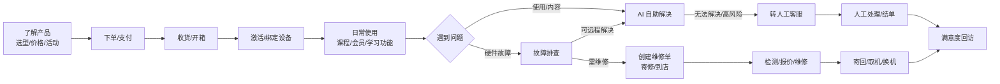
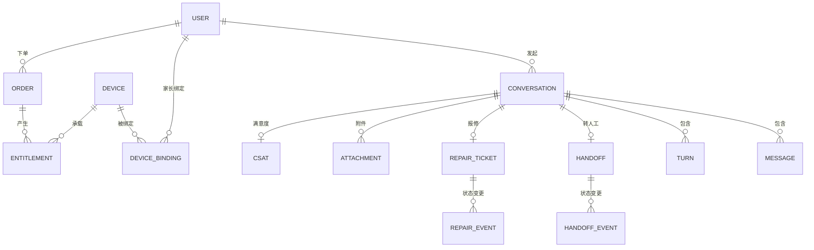
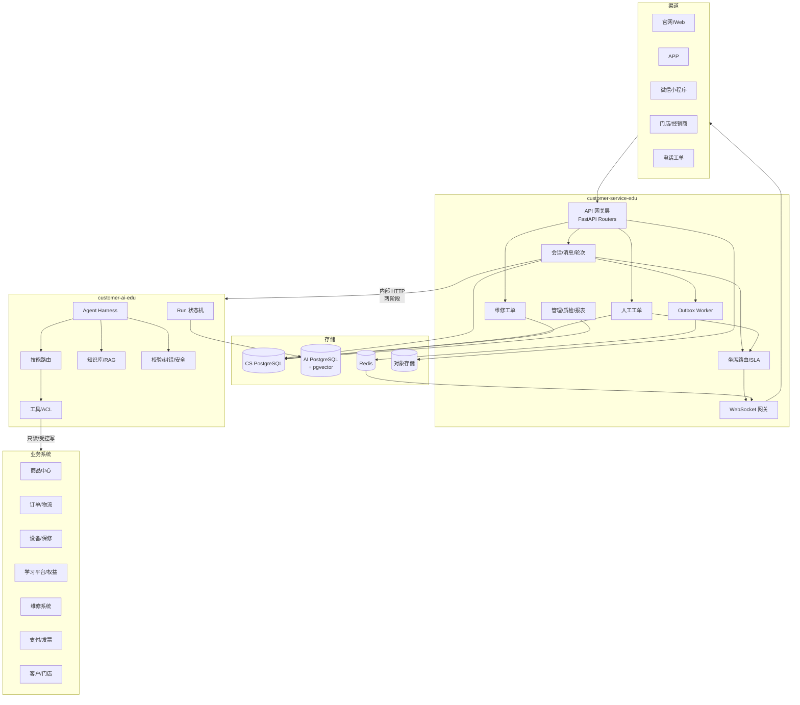
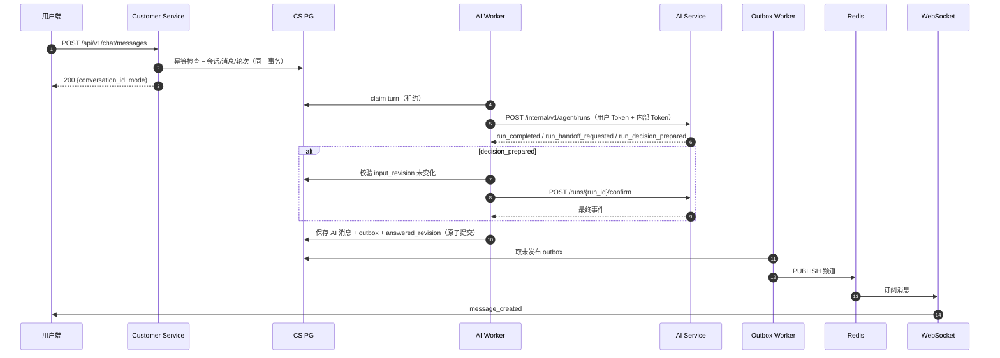
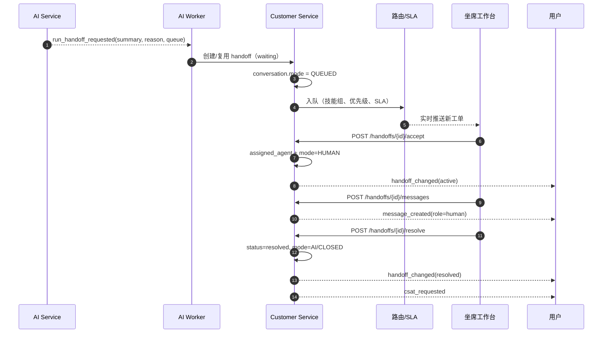
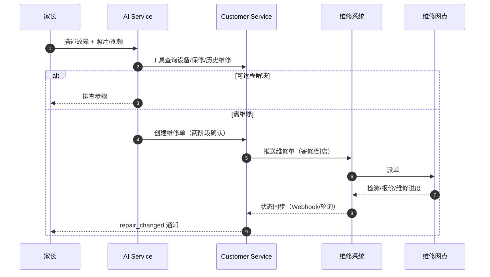

# 学习机智能客服 — 会话服务与人工工作台 PRD

| 项 | 内容 |
|---|---|
| 文档版本 | v0.2（已确认） |
| 文档状态 | **方案已确认，进入骨架搭建** |
| 编写日期 | 2026-10-26 |
| 确认日期 | 2026-10-26 |
| 适用项目 | `PRD/customer_service_edu` |
| 配套文档 | [`customer_ai_edu_PRD.md`](./customer_ai_edu_PRD.md) |
| 参考代码 | `C:\data\python_data\customer-service`、`C:\data\python_data\ai-service` |
| 阅读约定 | 【假设】= 尚未确认、按行业常规先假定；【待确认】= 需要你拍板；【建议】= 我的推荐方案 |

> 本文于 **2026-10-26 确认**。§0 是已确认结论，优先于下文；下文保留完整目标态，作为 Phase 2/3 的 Roadmap。所有“建议目标值”仍需结合现网基线校准；外部接口以对方实际 OpenAPI 为准。

---

## 0. 已确认方案（v0.2）

### 0.1 已确认决策

| ID | 决策 | 确认结果 |
|---|---|---|
| A-01 | MVP 范围 | **只做售后**：订单物流 + 硬件故障 + 保修维修 + 政策咨询 + 投诉转人工 |
| A-02 | 业务对接 | **直接对接** OMS/ERP/CRM；暂无真实系统，先建表造数 + 契约/Mock |
| A-03 | 多租户 | **MVP 即多租户**：总部（HQ）+ 经销商（DEALER） |
| A-04 | 工单模型 | `handoffs` 与 `repair_tickets` 分开 |
| A-05 | AI 写操作 | 报修建单 + 取消未发货订单 |
| A-06 | 多模态 | 文本 + 图片 |
| A-07 | 工作台 | 仅后端 API |
| A-08 | 部署 | 单机 Docker Compose @ `192.168.168.100` |
| A-09 | 模型 | 多模型路由（七牛云 OpenAI 兼容接口） |
| A-10 | 知识库 | PostgreSQL 元数据 + Milvus 向量/BM25；embedding 用 `bge-m3` |
| B01–B30 | 技术改造 | 全部采纳 |

### 0.2 MVP 功能边界

**做**：多租户会话/消息/轮次、AI 两阶段、转人工与工单、维修工单、坐席 API、WebSocket、图片附件、知识库、审计、基础指标。

**不做（Phase 2+）**：售前导购、设备激活绑定、课程/会员、学习功能/学习报告、语音/视频、工作台前端、智能质检。

### 0.3 租户模型

- `tenants` 表：`id`、`code`、`type`（HQ / DEALER）、`name`、`parent_id`、`status`。
- 总部为根租户；经销商 `parent_id` 指向总部。
- 所有业务表带 `tenant_id` 且非空；所有查询强制租户过滤；JWT 必须包含 `tenant_id`。
- 总部坐席默认可见全部租户；经销商坐席仅可见本租户。跨租户查看需显式授权并写审计。
- 知识、话术、技能组、坐席、维修单、统计按租户隔离；公共知识归属 HQ，用可见范围字段控制下发。

### 0.4 数据与部署

- 新建库：`edu_customer_service`、`edu_ai_service`（PostgreSQL）。
- 表由 Alembic 创建；测试数据由 seed 脚本生成（总部/经销商、家长/学生、设备、订单、保修、维修单、知识）。
- 部署：`192.168.168.100` 单机 Docker Compose；PG/Redis/Milvus/MinIO 复用主机现有实例。
- 环境与连接信息见 [`../config.md`](../config.md)。

### 0.5 阶段目标

| 阶段 | 范围 |
|---|---|
| Phase 0 | 修复阻断缺陷、建库建表、测试数据、Compose 基线 |
| Phase 1 | 售后 MVP：订单/故障/维修/政策/转人工 |
| Phase 2 | 售前、设备激活、课程会员、学习功能、语音 |
| Phase 3 | 多渠道规模化、智能质检、合规认证 |

---

## 1. 背景与目标

### 1.1 行业背景：学习机不是普通电商

学习机公司的业务是 **“硬件 + 内容 + 服务 + 售后”** 的长周期生意，和参考项目的电商客服有本质差异：

| 维度 | 电商客服（参考项目） | 学习机客服（本项目） |
|---|---|---|
| 核心对象 | 商品、订单、物流、售后单 | 设备（SN）、订单、课程/会员权益、保修、维修单、学习账号 |
| 用户关系 | 买家本人 | **家长付费 + 学生使用**，常为未成年人 |
| 售后形态 | 退换货、退款为主 | **保修判定、寄修/到店维修、备件、换机、上门** |
| 内容依赖 | 商品规则、平台政策 | 产品说明书、故障码、固件升级、课程使用、家长管控、教育政策 |
| 服务周期 | 交易后数周 | **购机后 1–5 年**，贯穿激活、使用、续费、维修、换机 |
| 合规要求 | 电商法、消保法 | 叠加 **未成年人保护、个人信息保护、儿童个人信息、内容安全** |
| 渠道 | 官网/APP | 官网、APP、微信小程序、公众号、线下门店、经销商、电话 |

因此不能把参考项目简单改个名字就用。**会话与工单骨架可复用，领域模型、AI 技能、工具、知识库、售后流程必须重做。**

### 1.2 参考项目可复用的能力

参考项目已经具备一套质量不错的“客服中台骨架”，建议保留并演进：

| 能力 | 位置 | 复用结论 |
|---|---|---|
| 会话 / 轮次 / 消息三级模型 | `customer-service/atguigu/models/models.py` | **保留**，扩展字段 |
| 单用户单开放会话（部分唯一索引） | `conversations` 表 | **保留**，多租户/多渠道时改复合键 |
| 轮次防抖合并 + 租约 + 重试 | `conversation_turns`、`TurnService` | **保留**，参数按学习机调优 |
| AI 两阶段提交（prepare/confirm） | `AIWorker`、`AIServiceGateway` | **保留**，这是核心资产 |
| 输入版本号 + SUPERSEDED | `input_revision` / `snapshot_revision` | **保留** |
| 事务性 Outbox | `realtime_outbox` + `OutboxWorker` | **保留**，升级并发与重放 |
| 人工工单（接单/回复/结束） | `HandoffService` | **保留**，扩展类型与 SLA |
| Redis Pub/Sub → WebSocket | `routers/realtime.py` | **保留**，升级协议与重连 |
| 管理指标 | `AdminMetricsService` | **保留**，扩展客服指标 |
| AI Harness（技能/工具/校验/纠错） | `ai-service/atguigu/agent/harness` | **保留**，替换为教育领域 |

### 1.3 现有能力与学习机场景的关键差距

| # | 差距 | 现状 | 学习机要求 |
|---|---|---|---|
| G1 | 没有设备主数据 | 只有 `user_id` | 需要 `device_sn`、型号、激活状态、绑定关系、保修状态 |
| G2 | 没有权益/课程上下文 | 无 | 课程开通、会员到期、订单权益、退款状态 |
| G3 | 售后只有“转人工” | `handoffs` 一种工单 | 需要人工客服工单 + **维修工单** 两条闭环 |
| G4 | 没有坐席/技能组/路由 | 任何 agent 可接任何单 | 按业务线（售前/订单/设备/课程/维修/投诉）路由 |
| G5 | 没有 SLA/优先级 | 按创建时间排序 | 投诉、未成年人、支付风险优先；超时升级 |
| G6 | 消息只有 text/object | `MessageType` 两种 | 图片、语音、视频、文件、卡片、系统通知 |
| G7 | 没有知识库 | AI 侧硬编码 3 条知识 | 产品手册、FAQ、政策、故障库、课程文档，带引用 |
| G8 | 没有未成年人/隐私合规 | 无 | 监护人同意、最小化收集、脱敏、留存与删除 |
| G9 | 没有质检/CSAT/标签 | 无 | 会话小结、标签、满意度、抽检、bad case 回流 |
| G10 | 没有多租户/渠道 | 单租户、单渠道 | 官网/APP/小程序/门店/经销商，至少预留字段 |
| G11 | 工程化不足 | 无 Alembic、测试少、无健康检查 | 迁移、CI、契约测试、可观测性 |
| G12 | 参考代码存在阻断性缺陷 | 见 §12 | 先修复再 fork |

### 1.4 产品目标

1. **一个客服中台**支撑全渠道（官网/APP/小程序/门店/电话工单），统一会话、工单、知识、数据。
2. **AI 优先、人工兜底**：常见问题 AI 独立解决；复杂/高风险/情绪问题平滑转人工。
3. **售后闭环**：从“用户说设备坏了”到“维修完成/换机完成”可追踪、可通知、可统计。
4. **合规可控**：未成年人、个人信息、内容安全有明确边界和审计。
5. **可运营**：知识、话术、路由、SLA、质检、指标都能在后台配置和迭代。

### 1.5 成功指标（建议目标，需基线校准）

| 指标 | 定义 | 建议目标 |
|---|---|---|
| MET-01 AI 独立解决率 | 未转人工且 24h 内无重复咨询的会话 / 总会话 | ≥ 55% |
| MET-02 转人工率 | 创建人工工单的会话 / 总会话 | ≤ 35% |
| MET-03 AI 首响时延 | 用户消息 → AI 首条回复 P95 | ≤ 5 s |
| MET-04 人工首响时延 | 转人工 → 坐席首条回复 P95 | ≤ 60 s（工作时间） |
| MET-05 一次解决率 | 72h 内无同问题重复会话 / 已解决会话 | ≥ 80% |
| MET-06 CSAT | 满意度评分均值 | ≥ 4.5 / 5 |
| MET-07 维修闭环率 | 已完结维修单 / 已创建维修单 | ≥ 95% |
| MET-08 会话接口可用性 | 月度 | ≥ 99.9% |
| MET-09 消息端到端时延 | 写入 → WebSocket 送达 P95 | ≤ 1 s |
| MET-10 知识引用准确率 | 抽检回答有正确引用 / 抽检回答 | ≥ 95% |

### 1.6 非目标（本期不做）

- 不做完整 ERP/OMS/CRM/维修网点管理系统，只做**客服侧闭环**与集成。
- 不做课程内容生产、直播、题库。
- 不做电话呼叫中心底层（可对接现有呼叫中心，做“电话工单”接入）。
- 不做电商交易、支付、物流履约本身。
- 不做经销商结算/分账。

---

## 2. 用户与角色

### 2.1 角色定义

| 角色 | 说明 | 典型诉求 | 权限要点 |
|---|---|---|---|
| 家长（主账号） | 购机/付费/监护人 | 订单、发票、保修、维修、退款、管控 | 可查看并管理绑定设备与学习数据 |
| 学生（子账号） | 设备使用者，可能未成年 | 课程打不开、功能怎么用、错题/口语评测 | 仅能咨询与学习相关；敏感操作需家长确认 |
| 人工客服 | 售前/订单/设备/课程/投诉坐席 | 接单、查上下文、回复、转接、结单 | 按技能组看单；仅处理自己接的单 |
| 维修工程师/网点 | 寄修/到店维修 | 收件、检测、报价、维修、寄回 | 仅看维修单与设备信息 |
| 客服主管 | 排班、质检、升级处理 | 看板、改派、强插、抽检 | 全量工单与报表 |
| 知识运营 | 维护知识库/话术 | 新增、审核、发布、下线 | 知识库管理 |
| 管理员 | 系统配置 | 坐席、技能组、SLA、渠道、权限 | 全量配置与审计 |
| AI Service | 内部服务 | 读取上下文、返回决策 | 内部 Token + 用户 Token |

### 2.2 核心用户旅程



### 2.3 场景清单（MVP 优先级）

| 场景 ID | 场景 | 主要角色 | 处理方式 | 依赖系统 | 优先级 |
|---|---|---|---|---|---|
| S-01 | 售前选型：年级/学科/预算/型号对比 | 家长 | AI 为主 | 商品中心、价格/活动 | P0 |
| S-02 | 订单状态、发货、物流 | 家长 | AI 为主 | OMS、物流 | P0 |
| S-03 | 改地址/取消订单/申请退款 | 家长 | AI 引导 + 两阶段写操作 | OMS、支付 | P1 |
| S-04 | 发票申请/下载 | 家长 | AI 引导 | 发票系统 | P1 |
| S-05 | 设备激活、绑定、解绑、换绑 | 家长 | AI + 人工 | 设备中心、账号中心 | P0 |
| S-06 | 课程/会员开通、到期、续费、退款 | 家长/学生 | AI + 人工 | 学习平台、权益中心 | P0 |
| S-07 | 学习功能使用（同步课、AI 错题、口语评测、家长管控） | 家长/学生 | AI + 知识库 | 学习平台 | P0 |
| S-08 | 硬件故障排查（不开机、黑屏、无法充电、触控、网络） | 家长 | AI 故障树 + 人工 | 知识库、维修系统 | P0 |
| S-09 | 保修查询、保修争议 | 家长 | AI 查询 + 人工 | 设备中心、保修系统 | P1 |
| S-10 | 报修/寄修/到店预约/维修进度 | 家长 | AI + 维修工单 | 维修系统、物流 | P0 |
| S-11 | 投诉、情绪激动、舆情风险 | 家长 | 立即转人工 | 工单 | P0 |
| S-12 | 未成年人误充值/内容安全/隐私请求 | 家长/学生 | 立即转人工 + 风控 | 支付、风控、合规 | P0 |
| S-13 | 系统升级/固件问题 | 家长 | AI + 知识库 | OTA | P1 |
| S-14 | 配件购买/更换 | 家长 | AI + 商品/订单 | 商品中心 | P2 |
| S-15 | 门店/经销商服务查询 | 家长 | AI + 门店系统 | 门店系统 | P2 |

---

## 3. 术语与领域模型

| 术语 | 定义 |
|---|---|
| 会话 Conversation | 一次完整的服务上下文；同一用户同时最多一个“开放”会话（多租户/多渠道时按渠道隔离） |
| 轮次 Turn | 一次“用户输入 → AI 处理 → 输出”的单元；支持防抖合并、租约、重试 |
| 消息 Message | 会话中的一条内容；`role` 区分 user / ai / human / system |
| 人工工单 Handoff | 需要人工客服介入的服务请求；`waiting → active → resolved` |
| 维修单 RepairTicket | 需要检测/维修/换机的售后请求；与人工工单解耦，有自己的状态机 |
| 设备 Device | 学习机硬件，以 SN 唯一标识；含型号、激活、绑定、保修 |
| 权益 Entitlement | 课程/会员/服务的使用权；含有效期、状态、退款 |
| 技能组 SkillGroup | 坐席能力分组，如售前组、订单组、设备组、课程组、维修组、投诉组 |
| SLA | 服务时限；含首响、处理、解决三个维度 |
| 会话上下文 Context | 与会话关联的订单、设备、权益、维修单等业务对象引用与快照 |

### 3.1 领域关系



> 说明：`USER`、`DEVICE`、`ORDER`、`ENTITLEMENT` 的**主数据在业务系统**，客服库只保存引用 + 必要快照，避免双写与脏数据。

---

## 4. 总体架构

### 4.1 服务边界

| 服务 | 职责 | 不负责 |
|---|---|---|
| **customer-service-edu**（本项目） | 会话、消息、轮次、人工工单、维修工单、坐席路由、实时推送、工作台 API、审计、满意度 | 业务主数据、AI 推理、知识生产 |
| **customer-ai-edu**（配套项目） | 意图识别、技能路由、工具调用、RAG、输出校验、转人工决策、AI 运行审计 | 会话存储、人工工单状态机、实时推送 |
| **业务系统**（已有/新建） | 商品、订单、物流、设备、保修、课程/权益、维修、支付、发票、门店 | 客服会话 |
| **基础设施** | PostgreSQL、Redis、对象存储、可选 MQ | — |

### 4.2 架构图



### 4.3 关键数据流

#### 4.3.1 用户消息 → AI 回复



#### 4.3.2 转人工



#### 4.3.3 报修



### 4.4 部署拓扑（已确认）

部署主机：`192.168.168.100`，Docker 已安装，单机 Docker Compose。

| 组件 | 副本 | 说明 |
|---|---|---|
| customer-service API | 1 | 容器；HTTP + WebSocket |
| AI Worker | 1 | 容器；后续可多副本靠租约抢单 |
| Outbox Worker | 1 | 容器；使用 `SKIP LOCKED` |
| customer-ai-edu | 1 | 容器；内部端口 8002 |
| PostgreSQL | 复用主机 | 新建 `edu_customer_service`、`edu_ai_service` |
| Redis | 复用主机 | `192.168.168.100:6379`，开发环境无密码 |
| Milvus | 复用主机 | `192.168.168.100:19530`，v2.5.5 |
| MinIO | 复用主机 | `192.168.168.100:9000`，附件存储 |

> 生产扩容时再拆分为多副本/托管实例；本期不引入 K8s。

---

## 5. 功能需求

> 优先级：P0 = MVP 必须；P1 = 第二阶段；P2 = 后续。
> 每条需求给出“规则 + 验收标准”，便于开发与测试对齐。

### 5.1 渠道与身份

#### FR-CS-001 多渠道接入（P0）

- 支持来源：官网 Web、APP、微信小程序、公众号、门店/经销商工作台、电话工单（人工录入）。
- 每个会话记录 `channel`、`source`、`tenant_id`（预留）、`external_session_id`。
- 同一用户在不同渠道的会话**默认隔离**；跨渠道历史可由客服在工作台查看（需权限）。
- 验收：同一家长从 APP 和小程序进入，生成两个会话；坐席可在用户画像中看到全部历史。

#### FR-CS-002 身份与角色（P0）

- JWT 至少包含：`user_id`、`role`、`tenant_id`、`channel`、`exp`、`aud`。
- 角色：`customer` / `agent` / `supervisor` / `admin` / `engineer`（维修）。
- 学生子账号：`subject_type=student`，`guardian_user_id` 必填；敏感操作需家长二次确认。
- 内部服务：`X-Internal-Service-Token` + 短时用户 Token；不得直接信任客户端传入的 `user_id`。
- 验收：伪造 `user_id` 无法越权；过期 Token 返回 401；角色不符返回 403。

#### FR-CS-003 会话上下文（P0）

- 会话可关联：`order_id`、`device_sn`、`product_model`、`entitlement_id`、`repair_ticket_id`、`store_id`。
- 上下文来源：用户选择、客户端传入、AI 工具查询、坐席手工绑定。
- 上下文采用“引用 + 快照”：引用业务系统 ID，快照关键字段（型号、保修到期、订单状态），带 `snapshot_at`。
- 验收：用户说“我的学习机开不了机”，AI 能定位到当前绑定设备；坐席能看到设备型号/保修状态/历史维修。

### 5.2 消息

#### FR-CS-010 消息类型（P0）

| 类型 | 说明 | MVP |
|---|---|---|
| `text` | 纯文本 | ✅ |
| `image` | 图片（故障照片、错误截图） | ✅ |
| `voice` | 语音（儿童/老人） | P1 |
| `video` | 视频（故障演示） | P1 |
| `file` | 文件（日志、发票） | P1 |
| `card` | 结构化卡片（订单、设备、课程、维修单） | ✅ |
| `system` | 系统提示（转接、结束、满意度） | ✅ |
| `notice` | 运营通知 | P2 |

- `content` 继续使用 JSONB，但**每种类型必须有 JSON Schema 校验**，禁止任意字典。
- 验收：非法 content 返回 422；图片消息必须带 `attachment_id`。

#### FR-CS-011 附件（P0）

- 新增 `attachments` 表：`id`、`conversation_id`、`message_id`、`uploader_id`、`mime`、`size`、`storage_key`、`sha256`、`scan_status`、`created_at`。
- 上传流程：申请预签名 URL → 客户端直传对象存储 → 回调确认 → 绑定消息。
- 限制：图片 ≤ 10 MB，视频 ≤ 100 MB，文件 ≤ 20 MB；类型白名单；病毒扫描；图片可生成缩略图。
- 验收：超大/非法类型被拒绝；未完成扫描的附件不能展示给坐席。

#### FR-CS-012 消息幂等（P0）

- 客户端生成 `message_id`（4–80 字符），服务端唯一约束。
- 重复请求直接返回首次结果，不重复写库、不重复触发轮次。
- 修复参考代码：重复分支返回 `conversation_id` 而不是 `conversation`（见 §12）。
- 验收：同一 `message_id` 连发 10 次，库里只有 1 条消息、1 个轮次。

#### FR-CS-013 撤回/脱敏（P1）

- 用户可在 2 分钟内撤回；坐席不可撤回，但可标记“敏感信息”。
- 脱敏：手机号、地址、身份证、学籍号、支付单号在展示与日志中掩码；原始值加密存储。
- 验收：撤回后前端显示“已撤回”，AI 上下文不再包含原文。

#### FR-CS-014 历史与增量同步（P0）

- `GET /api/v1/chat/history?after_sequence=<id>&limit=50`，按 `message.id` 升序。
- 返回 `sequence`、`conversation_started_at`；客户端用 `sequence` 去重与断点续传。
- 单次上限 200；超过用游标分页。
- 验收：断线重连后只拉新增消息，不重复、不丢。

### 5.3 AI 会话与轮次

#### FR-CS-020 防抖合并（P0）

- 用户连发多条消息合并为一轮；`message_merge_delay_ms` 默认 800ms，`max_wait` 默认 2000ms。
- 学习机场景建议：文字 800ms；图片/语音上传完成后重新计时；最长 3s。
- 验收：3 秒内连发 3 条，只触发一次 AI Run。

#### FR-CS-021 两阶段提交（P0）

- AI 返回 `run_decision_prepared` 时，Worker 在提交前校验 `snapshot_revision == conversation.input_revision`。
- 不一致则 `cancel_run` + `SUPERSEDED`，不把过期答案发给用户。
- 一致则 `confirm_run`，再落库。
- 验收：AI 思考期间用户又发言，旧答案不出现；新输入由下一轮处理。

#### FR-CS-022 租约/重试/回收（P0）

- Worker 领取轮次写入 `locked_by`、`locked_until`；崩溃后由其他 Worker 回收。
- 重试上限默认 3；超过标记 `FAILED`，给用户兜底话术并转人工（可配置）。
- 验收：杀掉 Worker 进程，轮次在租约到期后被重新处理，不重复发消息。

#### FR-CS-023 失败降级（P0）

- AI 超时/不可用：返回“正在为您转接人工/请稍后重试”，并创建工单或重试。
- 不得向用户暴露模型、堆栈、内部错误码。
- 验收：AI Service 宕机时，用户仍能收到可理解提示，工单可创建。

### 5.4 转人工

#### FR-CS-030 转人工触发（P0）

触发来源：
1. AI 决策 `REQUEST_HANDOFF`（用户明确要求、投诉、风险、未成年人、支付争议）。
2. 用户点击“转人工”。
3. AI 连续失败/工具连续失败。
4. 坐席主动接入（监管/强插）。
5. SLA 超时升级。

规则：
- 同一会话同时最多一个开放工单。
- 转人工时保存 AI 摘要（给坐席）和用户提示（给用户）。
- `summary` 必须包含：用户目标、已查到的关键事实、已尝试的操作、建议下一步。
- 验收：转人工后用户端显示“排队中/已接入”，坐席端 1s 内收到工单。

#### FR-CS-031 排队与路由（P0）

- 队列维度：`tenant_id` + `skill_group` + `priority`。
- 路由策略（MVP）：技能组匹配 → 在线且未满负荷 → 最久未接单/最少会话数。
- 优先级：P0 投诉/未成年人/支付风险；P1 维修/保修；P2 普通咨询。
- 溢出：无人可接时进入等待，超时升级给主管或转留言/工单。
- 验收：设备组工单不会派给售前组；满负荷坐席不再接新单。

#### FR-CS-032 接单/转接（P0）

- 接单：`waiting → active`，写 `assigned_agent_id`、`accepted_at`；重复接单幂等。
- 转接：`active → waiting`（换组）或直接指派；记录 `handoff_events`。
- 坐席只能回复/结束自己负责的工单；主管可改派。
- 验收：非负责人回复返回 403；转接后原坐席失去写权限。

#### FR-CS-033 SLA 与升级（P1）

| 维度 | 起算 | 目标（建议） |
|---|---|---|
| 首响 | 工单创建 | 工作时间 60s |
| 处理中 | 接单 | 每 10 分钟至少一次更新 |
| 解决 | 接单 | 普通 2h，维修 48h |
| 满意度 | 结单 | 24h 内回收 |

- 超时：提醒坐席 → 升级主管 → 改派。
- 验收：超时工单在看板标红，并有升级记录。

### 5.5 人工工作台

#### FR-CS-040 工单列表（P0）

- 筛选：状态、技能组、优先级、渠道、标签、设备型号、SLA 状态、坐席。
- 排序：优先级 → 等待时长 → 创建时间。
- 列表字段：用户、摘要、设备/订单、等待时长、SLA、最后一条消息。
- 验收：1000 条工单下翻页 < 500ms。

#### FR-CS-041 会话详情（P0）

- 左侧：会话消息流（user/ai/human/system，含附件、卡片）。
- 右侧：用户画像、设备、订单、权益、保修、历史工单、历史维修、AI 摘要、标签。
- 支持按消息跳转、复制、引用回复。
- 验收：坐席在一个页面完成 80% 的上下文判断，不需要跳转 3 个系统。

#### FR-CS-042 回复与快捷话术（P0）

- 文本 + 附件 + 卡片；支持快捷话术、变量（用户称呼、订单号、设备型号）。
- 发送幂等：`message_id` 客户端生成；重复提交不重复发。
- 敏感词/合规检查；禁止承诺未授权的退款/赔偿。
- 验收：快捷话术可配置、可审核；违规话术被拦截或提示。

#### FR-CS-043 结束与小结（P0）

- 结单必填：解决状态、问题分类、根因、处理动作、是否需回访。
- 自动生成 `ai_summary`，坐席可编辑。
- 标签：产品型号、问题域、渠道、风险等级。
- 验收：结单后工单不可再回复；统计报表可按分类聚合。

#### FR-CS-044 满意度（P1）

- 结单后 24h 内推送 1–5 星 + 可选标签 + 文本。
- 低分（≤2）自动创建回访工单/升级主管。
- 验收：满意度回收率、低分跟进率可统计。

### 5.6 维修工单

#### FR-CS-050 报修创建（P0）

- 来源：AI 判断需维修、用户主动报修、坐席代建。
- 必填：设备 SN、故障现象、故障类型、购买凭证/保修状态、联系方式、寄修/到店。
- 支持图片/视频；故障描述可引用会话消息。
- 验收：维修单创建后，用户收到维修单号与寄修指引。

#### FR-CS-051 寄修/到店（P0）

- 寄修：生成寄修地址、物流单号、收件确认；跟踪物流。
- 到店：选择门店/网点、预约时间、二维码/取件码。
- 验收：用户能在会话内查看“寄修进度/预约二维码”。

#### FR-CS-052 维修进度（P0）

- 状态：`created → received → diagnosing → quoted → repairing → completed → shipped → closed`（可按实际调整）。
- 与维修系统同步：Webhook 优先，轮询兜底。
- 关键节点主动通知用户（站内 + 微信模板消息/短信）。
- 验收：状态变化 1 分钟内推送到用户端；用户可在会话内查询。

#### FR-CS-053 备件/换机/报价（P1）

- 报价需用户确认；超时未确认自动关闭或转人工。
- 换机：生成换机单，记录旧机 SN、新机 SN、原因、责任判定。
- 验收：报价确认/拒绝有审计；换机后设备绑定关系自动更新（或生成待绑定任务）。

### 5.7 实时消息

#### FR-CS-060 WebSocket 连接（P0）

- 连接后先发 `auth` 帧（短时 ticket，而非长期 JWT）；服务端校验后订阅频道。
- 心跳：客户端 25s ping，服务端 30s 超时断开。
- 频道：用户频道、坐席频道、技能组频道、维修频道。
- 验收：Token 过期/非法被拒绝；断线后 5s 内可重连。

#### FR-CS-061 事件类型（P0）

| 事件 | 接收方 | 载荷 |
|---|---|---|
| `message_created` | 用户/坐席/技能组 | message 完整结构 |
| `handoff_changed` | 用户/坐席/技能组 | handoff_id, status, assigned_agent_id, summary |
| `repair_changed` | 用户/维修/坐席 | repair_id, status, next_action |
| `conversation_closed` | 用户/坐席 | conversation_id, reason |
| `csat_requested` | 用户 | survey_id, expires_at |
| `typing` | 对端 | conversation_id, role |
| `connected` / `ping` / `pong` | 客户端 | 协议帧 |

#### FR-CS-062 断线重连与补发（P0）

- 客户端携带 `last_event_id`/`last_sequence` 重连；服务端从 Outbox/消息表补发。
- 事件 `event_id` 全局唯一；客户端按 `event_id` 去重。
- 验收：断网 2 分钟后重连，消息不丢、不重、不乱序。

#### FR-CS-063 多端同步（P1）

- 同一用户多端在线：消息已读状态、正在输入、会话状态同步。
- 验收：APP 已读后，小程序未读数同步下降。

### 5.8 知识库与话术

#### FR-CS-070 知识管理（P0，AI 侧实现，客服侧提供入口）

- 知识类型：产品手册、FAQ、政策、故障库、课程文档、维修指引、话术。
- 生命周期：草稿 → 审核 → 发布 → 下线；版本化；生效时间；适用型号/渠道/租户。
- 来源：运营录入、文档导入、工单沉淀、bad case 回流。
- 验收：知识变更可追溯到人、时间、版本；下线后 AI 不再引用。

#### FR-CS-071 快捷话术（P1）

- 分类、变量、适用场景、审核状态；坐席可收藏。
- 验收：话术使用率、满意度可按话术统计。

### 5.9 管理与质检

#### FR-CS-080 坐席管理（P0）

- 坐席档案、技能组、在线状态、最大并发、班次。
- 验收：停用坐席不能再接单；技能组变更实时生效。

#### FR-CS-081 报表（P1）

- 会话量、AI 解决率、转人工率、首响、解决时长、CSAT、维修闭环、知识命中、工具失败。
- 维度：时间、渠道、技能组、坐席、产品型号、问题分类。
- 验收：日报/周报可导出；口径与埋点一致。

#### FR-CS-082 质检（P1）

- 规则质检：敏感词、禁语、承诺赔付、长时间未回复、未结单。
- 人工抽检：抽样比例、评分表、申诉。
- bad case 回流到知识库/评测集。
- 验收：质检结果可关联到具体消息与会话。

#### FR-CS-083 审计（P0）

- 记录：登录、查看敏感数据、改派、结单、导出、配置变更、权限变更。
- 保留 ≥ 1 年（按合规要求调整）。
- 验收：任意敏感操作可按人/时间/对象检索。

### 5.10 合规与隐私

#### FR-CS-090 未成年人保护（P0）

- 识别学生子账号/未成年人；涉及充值、退款、隐私、内容安全时**优先转人工**。
- 不向未成年人收集非必要个人信息；涉及监护人权利请求转合规流程。
- 内容安全：输入/输出双向过滤；违规内容阻断并记录。
- 验收：未成年人误充值场景 100% 转人工并生成高风险工单。

#### FR-CS-091 个人信息保护（P0）

- 最小化收集；明确告知；单独同意（敏感信息）。
- 展示脱敏；日志脱敏；导出审批；删除/更正请求可执行。
- 数据保留：会话/消息默认 2 年（可配置）；附件 1 年；AI 运行记录 6 个月（建议）。
- 验收：删除请求在承诺时限内完成，并有审计记录。

#### FR-CS-092 内容安全（P0）

- 用户上传图片/视频/文件需审核（机审 + 人审抽检）。
- AI 输出不得包含：政治敏感、色情、暴力、歧视、医疗诊断、投资建议、虚假承诺。
- 验收：违规样本拦截率 ≥ 99%（按评测集）。

---

## 6. 数据模型

### 6.1 现有表改造

#### 6.1.1 `conversations`

| 字段 | 变更 | 说明 |
|---|---|---|
| `id` | 保留 | `conv_<uuid>` |
| `user_id` | 保留 | 业务用户 ID |
| `tenant_id` | 新增 | **必填**；HQ 或 DEALER；所有查询强制过滤 |
| `channel` | 新增 | web/app/miniprogram/store/phone |
| `source` | 新增 | 具体来源，如 `app-ios` |
| `subject_type` | 新增 | parent/student/agent |
| `guardian_user_id` | 新增 | 学生子账号的监护人 |
| `mode` | 扩展 | `AI` / `QUEUED` / `HUMAN` / `REPAIR` / `CLOSED`（或保持四态，用单据表达维修） |
| `priority` | 新增 | P0/P1/P2 |
| `skill_group` | 新增 | 当前路由技能组 |
| `context` | 新增 JSONB | order/device/entitlement/repair 引用与快照 |
| `close_reason` | 新增 | resolved/timeout/user_left/blocked |
| `satisfaction` | 新增 | 1–5 |
| `last_message_at` | 新增 | 列表排序 |
| `unread_user` / `unread_agent` | 新增 | 未读数 |
| `ai_summary` | 新增 | 会话摘要 |
| `started_at` / `last_active_at` / `ended_at` | 保留 | — |

约束调整：
- 单开放会话唯一索引改为 `(tenant_id, user_id, channel)` 部分唯一（已确认按渠道隔离）。
- `mode` 增加 `REPAIR` 时，需同步调整部分唯一索引条件。

#### 6.1.2 `messages`

| 字段 | 变更 | 说明 |
|---|---|---|
| `message_id` | 保留 | 客户端幂等键；建议加 `tenant_id` 前缀或复合唯一 |
| `role` | 扩展 | user/ai/human/system |
| `message_type` | 扩展 | text/image/voice/video/file/card/system/notice |
| `content` | 保留 JSONB | 每种类型有 JSON Schema |
| `sender_id` | 新增 | 真实发送者（坐席/用户/系统） |
| `client_created_at` | 新增 | 客户端时间，用于排序兜底 |
| `moderation_status` | 新增 | pending/passed/rejected |
| `redacted_at` | 新增 | 脱敏/撤回时间 |
| `reply_to_message_id` | 新增 | 引用回复 |
| `delivery_status` | 新增 | sent/delivered/read |
| `agent_run_id` / `agent_outcome_seq` | 保留 | AI 幂等 |
| `input_revision` | 保留 | 版本 |

#### 6.1.3 `handoffs`

| 字段 | 变更 | 说明 |
|---|---|---|
| `type` | 新增 | human/repair/complaint/technical/minor_protection |
| `skill_group` | 新增 | 路由技能组 |
| `queue` | 新增 | 队列 |
| `priority` | 新增 | P0/P1/P2 |
| `reason_code` | 新增 | AI 给出的原因 |
| `ai_summary` | 新增 | 给坐席的摘要 |
| `sla_due_at` | 新增 | 首响/解决时限 |
| `first_response_at` | 新增 | 首响时间 |
| `transferred_from` | 新增 | 转接来源 |
| `resolution_code` | 新增 | 解决分类 |
| `resolution_note` | 新增 | 处理说明 |
| `csat_score` | 新增 | 满意度 |
| `repair_ticket_id` | 新增 | 关联维修单 |
| `context` | 新增 JSONB | 订单/设备/权益快照 |

约束：
- 同一会话同时最多一个开放工单（部分唯一索引）。
- 同一用户同时最多一个开放工单（可按租户/渠道调整）。

#### 6.1.4 `conversation_turns`

保持核心结构，建议补充：
- `request_id`（唯一）：`turn_id:attempt:n`，用于 AI 侧幂等。
- `ai_run_state`：便于排查。
- `queue_wait_ms` / `run_latency_ms`：指标。
- `error_code`：结构化错误。

#### 6.1.5 `realtime_outbox`

| 字段 | 变更 | 说明 |
|---|---|---|
| `event_id` | 保留 | 全局唯一 |
| `sequence` | 保留 | 单调游标 |
| `channel` | 保留 | 频道 |
| `event_type` | 保留 | 事件类型 |
| `event_version` | 新增 | 契约版本 |
| `dedupe_key` | 新增 | 幂等键 |
| `partition_key` | 新增 | 顺序键（conversation_id） |
| `payload` | 重命名 `data` | 统一 |
| `attempts` | 保留 | 重试次数 |
| `next_retry_at` | 新增 | 退避 |
| `last_error` | 新增 | 错误 |
| `published_at` | 保留 | 发布时间 |
| `dead_letter_at` | 新增 | 死信时间 |

索引：`(published_at, sequence)`、`(channel, sequence)`、`(dedupe_key)`。

### 6.2 新增表

| 表 | 关键字段 | 说明 |
|---|---|---|
| `tenants` | id, code, type(HQ/DEALER), name, parent_id, status, created_at | 租户；总部为根，经销商挂总部 |
| `agents` | id, tenant_id, name, status, max_concurrent, skills, created_at | 坐席档案 |
| `agent_skills` | agent_id, skill_group, level | 技能 |
| `agent_status_logs` | agent_id, status, changed_at | 在线/忙碌/离线 |
| `skill_groups` | id, tenant_id, name, sla_config, routing_strategy | 技能组 |
| `handoff_events` | id, handoff_id, from_status, to_status, operator_id, note, created_at | 工单流水 |
| `repair_tickets` | id, tenant_id, user_id, conversation_id, device_sn, fault_type, status, channel, store_id, warranty_status, quote_amount, created_at, closed_at | 维修单 |
| `repair_events` | id, repair_id, from_status, to_status, operator_id, note, attachments, created_at | 维修流水 |
| `attachments` | id, conversation_id, message_id, uploader_id, mime, size, storage_key, sha256, scan_status, created_at | 附件 |
| `conversation_contexts` | conversation_id, context_type, ref_id, snapshot JSONB, snapshot_at | 上下文（也可并入 conversations.context） |
| `csat_surveys` | id, conversation_id, handoff_id, score, tags, comment, created_at | 满意度 |
| `tags` / `conversation_tags` | id, name, category; conversation_id, tag_id | 标签 |
| `audit_logs` | id, tenant_id, actor_id, action, object_type, object_id, before, after, ip, created_at | 审计 |
| `canned_replies` | id, tenant_id, category, title, content, variables, status | 快捷话术 |
| `knowledge_articles` | 见 AI PRD，可放 AI 库 | 知识 |
| `outbox_dead_letters` | 可选 | 死信 |

### 6.3 关键约束与索引

```sql
-- 单开放会话（按租户+用户+渠道）
CREATE UNIQUE INDEX uq_open_conversation_per_user_channel
  ON conversations (tenant_id, user_id, channel)
  WHERE mode IN ('AI','QUEUED','HUMAN','REPAIR');

-- 单会话单开放工单
CREATE UNIQUE INDEX uq_open_handoff_per_conversation
  ON handoffs (conversation_id)
  WHERE status IN ('waiting','active');

-- 单用户单开放工单（可按租户/渠道调整）
CREATE UNIQUE INDEX uq_open_handoff_per_user
  ON handoffs (tenant_id, user_id)
  WHERE status IN ('waiting','active');

-- 消息幂等
CREATE UNIQUE INDEX uq_message_id ON messages (message_id);
CREATE UNIQUE INDEX uq_conversation_input_revision
  ON messages (conversation_id, input_revision);

-- Outbox 拉取
CREATE INDEX idx_outbox_pending ON realtime_outbox (published_at, sequence)
  WHERE published_at IS NULL;
```

### 6.4 数据保留（建议，待法务确认）

| 数据 | 保留期 | 说明 |
|---|---|---|
| 会话/消息 | 2 年 | 可配置 |
| 附件 | 1 年 | 图片/视频 |
| AI Run / 工具调用 | 6 个月 | 含脱敏后的上下文 |
| 审计日志 | 3 年 | 合规 |
| 满意度 | 2 年 | — |
| 维修单 | 5 年 | 售后追溯 |

---

## 7. 接口设计

### 7.1 对外 HTTP API（C 端 / 坐席端）

| 方法 | 路径 | 角色 | 说明 | 变更 |
|---|---|---|---|---|
| POST | `/api/v1/conversations/current` | customer | 获取/创建当前会话 | 增加 context、channel |
| GET | `/api/v1/conversations/{id}` | agent/supervisor | 会话详情 | 增加分页、上下文 |
| POST | `/api/v1/chat/messages` | customer | 发送消息 | 增加附件、类型 |
| GET | `/api/v1/chat/history` | customer | 历史/增量 | 增加 limit/cursor |
| POST | `/api/v1/chat/messages/{id}/recall` | customer | 撤回 | 新增 |
| POST | `/api/v1/attachments/presign` | customer/agent | 申请上传 | 新增 |
| POST | `/api/v1/attachments/{id}/complete` | customer/agent | 确认上传 | 新增 |
| GET | `/api/v1/handoffs` | agent/supervisor | 工单列表 | 增加筛选/分页 |
| GET | `/api/v1/handoffs/{id}` | agent/supervisor | 工单详情 | 新增 |
| POST | `/api/v1/handoffs/{id}/accept` | agent | 接单 | 保留 |
| POST | `/api/v1/handoffs/{id}/messages` | agent | 回复 | 保留，增加附件 |
| POST | `/api/v1/handoffs/{id}/transfer` | agent/supervisor | 转接 | 新增 |
| POST | `/api/v1/handoffs/{id}/resolve` | agent | 结单 | 保留，增加分类 |
| POST | `/api/v1/handoffs/{id}/csat` | customer | 满意度 | 新增 |
| POST | `/api/v1/repair-tickets` | customer/agent | 创建维修单 | 新增 |
| GET | `/api/v1/repair-tickets/{id}` | customer/agent/engineer | 维修详情 | 新增 |
| POST | `/api/v1/repair-tickets/{id}/events` | engineer/system | 推进状态 | 新增 |
| GET | `/api/v1/admin/metrics` | admin | 指标 | 扩展 |
| GET | `/api/v1/admin/agents` | admin | 坐席管理 | 新增 |
| GET | `/api/v1/admin/queues` | admin | 队列/SLA | 新增 |
| GET | `/api/v1/admin/audit-logs` | admin | 审计 | 新增 |
| GET | `/healthz` | 无 | 健康检查 | 新增 |

> 约定：所有写接口支持 `Idempotency-Key`；错误返回统一 `{code, message, request_id}`；分页统一 `cursor` + `limit`。

### 7.2 内部 API（customer-service ↔ ai-service）

| 方法 | 路径 | 说明 |
|---|---|---|
| POST | `/internal/v1/agent/runs` | 启动 Run |
| POST | `/internal/v1/agent/runs/{run_id}/confirm` | 确认两阶段决策 |
| POST | `/internal/v1/agent/runs/{run_id}/cancel` | 取消 |
| GET | `/internal/v1/agent/runs/{run_id}` | 查询 Run（排查/补单） |
| POST | `/internal/v1/agent/runs/{run_id}/feedback` | 人工反馈（bad case） |

请求/响应契约见 AI PRD §8。

### 7.3 WebSocket 协议 v2

```jsonc
// 客户端 → 服务端：认证
{"type":"auth","ticket":"<short-lived-ticket>","last_event_id":"evt_..."}

// 服务端 → 客户端：认证结果
{"type":"auth_ok","user_id":"u_1001","channels":["user:u_1001"]}

// 客户端 → 服务端：订阅（坐席）
{"type":"subscribe","channels":["staff:group:device","staff:group:order"]}

// 服务端 → 客户端：业务事件
{"type":"event","event_id":"evt_...","event_type":"message_created","occurred_at":"...","data":{...}}

// 心跳
{"type":"ping"} / {"type":"pong"}

// 客户端确认
{"type":"ack","event_id":"evt_..."}
```

规则：
- 认证 5s 内未完成则断开。
- 单连接最多订阅 10 个频道。
- 服务端按 `event_id` 去重；客户端按 `event_id` 去重。
- 断线重连携带 `last_event_id`，补发上限 500 条；超过则提示客户端走 HTTP 历史接口。

### 7.4 事件契约

| 事件 | 版本 | 必填字段 |
|---|---|---|
| `message_created` | v1 | event_id, sequence, message_id, conversation_id, role, type, content, created_at |
| `handoff_changed` | v1 | event_id, handoff_id, conversation_id, status, assigned_agent_id, priority, sla_due_at |
| `repair_changed` | v1 | event_id, repair_id, conversation_id, device_sn, status, next_action |
| `conversation_closed` | v1 | event_id, conversation_id, reason, closed_at |
| `csat_requested` | v1 | event_id, conversation_id, survey_id, expires_at |

### 7.5 错误码（建议）

| code | HTTP | 含义 |
|---|---|---|
| `AUTH_REQUIRED` | 401 | 未认证 |
| `AUTH_FORBIDDEN` | 403 | 无权限 |
| `CONVERSATION_NOT_FOUND` | 404 | 会话不存在 |
| `HANDOFF_NOT_FOUND` | 404 | 工单不存在 |
| `HANDOFF_ALREADY_ACCEPTED` | 409 | 已被接单 |
| `HANDOFF_NOT_OWNER` | 403 | 非负责人 |
| `HANDOFF_CLOSED` | 409 | 工单已结束 |
| `MESSAGE_DUPLICATE` | 200 | 幂等命中（返回首次结果） |
| `ATTACHMENT_INVALID` | 422 | 附件类型/大小非法 |
| `RATE_LIMITED` | 429 | 触发限流 |
| `AI_UNAVAILABLE` | 503 | AI 服务不可用 |
| `INTERNAL_ERROR` | 500 | 未预期错误 |

---

## 8. 非功能需求

| 类别 | 要求 | 验收 |
|---|---|---|
| 性能 | 消息写 P95 ≤ 300ms；历史查询 P95 ≤ 500ms；WS 送达 P95 ≤ 1s | 压测报告 |
| 可用性 | 核心接口月可用性 ≥ 99.9% | 监控 |
| 扩展性 | API/WS/AI Worker 水平扩展；单用户会话不成为热点 | 2 倍压测 |
| 一致性 | 消息、轮次、outbox 同事务；工单与事件同事务 | 故障注入 |
| 幂等 | 消息、接单、回复、结单、AI Run 全部幂等 | 重复请求测试 |
| 安全 | JWT 短期 + 刷新；内部 Token；RBAC；租户隔离；限流 | 渗透测试 |
| 隐私 | 脱敏、加密、最小化、可删除 | 合规评审 |
| 可观测 | 结构化日志、Trace、指标、告警；每次请求有 request_id | 看板 |
| 可维护 | Alembic 迁移；OpenAPI；契约测试；CI | 流水线 |
| 兼容 | 事件契约版本化；旧客户端至少兼容 2 个版本 | 灰度 |

---

## 9. 指标与埋点

| 事件 | 触发 | 关键属性 |
|---|---|---|
| `conversation_started` | 创建会话 | channel, source, tenant |
| `message_sent` | 消息落库 | role, type, conversation_id |
| `turn_started` | 轮次创建 | conversation_id, start_revision |
| `turn_completed` | AI 完成 | latency, outcome, tokens |
| `turn_failed` | AI 失败 | error_code, attempts |
| `handoff_created` | 转人工 | reason, priority, skill_group |
| `handoff_accepted` | 接单 | agent_id, wait_ms |
| `handoff_resolved` | 结单 | resolution_code, handle_ms |
| `repair_created` | 报修 | fault_type, warranty_status |
| `repair_closed` | 维修完成 | cycle_time, result |
| `csat_submitted` | 满意度 | score, tags |
| `knowledge_cited` | AI 引用 | article_id, score |
| `tool_called` | 工具调用 | tool, success, latency |

> 所有事件带 `request_id`、`tenant_id`、`conversation_id`，便于串联。

---

## 10. 实施计划

### Phase 0：基线、数据库与测试数据（1–2 周）

- Fork 参考代码，重命名项目/包（`edu_cs` / `edu_ai`），修复 §12 的 C-01–C-15。
- 新建 PostgreSQL 库 `edu_customer_service`、`edu_ai_service`；引入 Alembic。
- 建表：租户、用户、会话、消息、轮次、工单、维修单、设备、保修、知识、审计。
- Seed 脚本生成测试数据：总部 + 2 个经销商、家长/学生、设备 SN、订单、保修、维修单、知识文章。
- Docker Compose 部署到 `192.168.168.100`；健康检查、结构化日志、CI。
- 产出：可一键启动、带测试数据的两服务基线。

### Phase 1：售后 MVP（4–6 周）

- 多租户会话/消息/轮次/附件/历史/WS 实时。
- 转人工：排队、技能组、接单、回复、转接、结单、CSAT。
- 维修工单：创建、寄修/到店、状态流转、进度查询、Mock 维修系统同步。
- 管理 API：租户、坐席、技能组、核心指标、审计。
- AI 侧 5 个技能：订单物流、硬件故障、保修维修、政策、投诉转人工（详见 AI PRD）。
- 产出：跑通“售后咨询 → AI → 转人工/报修 → 结单 → CSAT”闭环。

### Phase 2：范围扩展（4–6 周）

- 售前导购、设备激活绑定、课程/会员、学习功能（仅监护人）。
- 语音/多模态、知识运营、质检、报表。
- 产出：覆盖学习机全生命周期。

### Phase 3：规模化与合规（持续）

- 多渠道/更多经销商、坐席助手、知识自动沉淀。
- 等保/隐私合规认证、容灾与容量治理。

### 退出标准（建议）

- Phase 1：核心链路成功率 ≥ 99%，AI 独立解决率 ≥ 40%，转人工首响 ≤ 60s。
- Phase 2：维修闭环率 ≥ 95%，知识引用准确率 ≥ 95%，CSAT ≥ 4.3。

---

## 11. 风险与对策

| 风险 | 影响 | 对策 |
|---|---|---|
| 业务系统接口不稳定/字段不一致 | AI 工具失败、答非所问 | ACL 适配层 + 契约测试 + 失败降级 |
| AI 幻觉/承诺未授权操作 | 客诉、合规风险 | 事实校验 + 引用 + 动作白名单 + 两阶段确认 |
| 转人工集中爆发 | 排队超时、体验下降 | 技能组扩容、AI 兜底话术、SLA 升级、错峰 |
| 未成年人/隐私事件 | 监管与品牌风险 | 强制转人工、最小化收集、审计、演练 |
| 维修系统对接周期长 | 售后闭环延期 | 先做状态镜像 + 人工录入，再逐步自动化 |
| 历史数据迁移 | 会话断裂 | 迁移前冻结、双写影子期、校验对账 |
| 范围蔓延 | 延期 | 严格按 P0/P1/P2 排期，变更走评审 |
| 参考代码隐藏缺陷 | 上线故障 | Phase 0 修复 + 回归测试 + 灰度 |

---

## 12. 与参考代码的差异清单（必须修改）

> 以当前代码为准；`docs/` 中部分内容已过时。以下问题按“阻断 → 高 → 中”排序。

### 12.1 阻断/高危缺陷

| # | 位置 | 问题 | 影响 | 建议 |
|---|---|---|---|---|
| C-01 | `customer-service/atguigu/app/services/chat/message.py:50-52` | 幂等命中分支返回 `{"conversation": ...}`，但响应模型要求 `conversation_id` | 客户端重试时 500 | 改为 `{"conversation_id": conversation.id, "mode": ...}` |
| C-02 | `customer-service/atguigu/app/services/chat/conversation.py:102-108` | `get_message_payload` 返回 `message.id`（内部自增）作为 `message_id` | 前端拿到的不是业务 ID，且类型不符 | 返回 `message.message_id` |
| C-03 | `customer-service/atguigu/app/services/chat/conversation.py:69-86` | 只关闭 `mode=="AI"` 的过期会话 | `QUEUED/HUMAN` 会话永不自动关闭 | 查询所有开放模式，按各自策略关闭 |
| C-04 | `customer-service/atguigu/app/respositories/chat/conversation.py:23-28` | `get_ai_conversation` 无 `ORDER BY/LIMIT` | 多条时 `MultipleResultsFound` | 加 `ORDER BY last_active_at DESC LIMIT 1` |
| C-05 | `customer-service/atguigu/app/respositories/realtime.py:16-23` | `find_next_unpublished` 无 `FOR UPDATE SKIP LOCKED` | 多 Outbox Worker 重复发布 | 加锁 + `SKIP LOCKED` |
| C-06 | `customer-service/atguigu/worker/realtime.py:43-75` | 先发布 Redis 再提交；失败无退避/死信 | 重复或丢失；事件堆积 | `event_id` 去重 + 重试退避 + 死信 |
| C-07 | `customer-service/atguigu/app/routers/realtime.py:21-34` | WS 用首帧长期 JWT；无心跳/重放/多频道 | 安全与稳定性不足 | 短时 ticket + 心跳 + `last_event_id` |
| C-08 | `customer-service/atguigu/app/services/chat/turn.py:132-167` | `current_messages[0]` / `[-1]` 未判空 | 空轮次 IndexError | 空则标记失败/跳过 |
| C-09 | `customer-service/atguigu/worker/ai/result.py:32` | `agent_outcome_seq=1` 硬编码 | 一轮多条 AI 消息违反唯一约束 | 按产出顺序递增 |
| C-10 | `ai-service/atguigu/app/app.py:25-26` | `app.include_router(operations.router)`，`operations` 未定义 | **AI 服务启动即 NameError** | 改为 `admin.router` |
| C-11 | `ai-service/atguigu/agent/harness/run/coordinator.py:111-124` | `confirm_run` 不校验 `user_id` 和 `state` | 可确认他人/已结束的 Run | 校验归属 + 状态机 |
| C-12 | `ai-service/atguigu/agent/harness/run/coordinator.py:126-139` | `cancel_run` 不校验归属 | 越权取消 | 同上 |
| C-13 | `ai-service/atguigu/app/routers/run.py:32-43` | `/confirm` 不接收/校验 `input_revision` | 两阶段校验形同虚设（依赖调用方） | 服务端二次校验或明确契约 |
| C-14 | 两服务配置 | `encode_access_token` 用 `internal_service_jwt_secret`，AI 侧用 `jwt_secret` 解码 | 默认配置下内部 Token 校验失败 | 统一密钥/算法，启动时校验 |
| C-15 | `customer-service/atguigu/common/config.py:16` | `internal_service_token` 默认值与 AI 侧不一致 | 403 | 统一环境变量 |

### 12.2 领域/架构改造

| # | 位置 | 改造 |
|---|---|---|
| C-20 | 项目名/包名 | `ecommerce-*` → `edu-*`；`atguigu` → 业务包名；`infrastucture` → `infrastructure` |
| C-21 | `schemas/chat/message.py` | `MessageType` 扩展；每种类型 JSON Schema |
| C-22 | `models/models.py` | 新增 tenant/channel/context/priority/skill_group/attachments/repair 等 |
| C-23 | `services/admin/handoff.py` | 增加 type/priority/SLA/转接/结单分类；维修单独立 |
| C-24 | `worker/ai/worker.py` | 增加结构化错误码、指标、优雅退出 |
| C-25 | `worker/realtime.py` | 批量拉取、并发发布、退避、死信、监控 |
| C-26 | `routers/realtime.py` | 协议 v2、多频道、ticket、心跳、补发 |
| C-27 | `mock_ai/app.py` | `/commit` 与正式 `/confirm` 不一致，统一 |
| C-28 | 全项目 | 引入 Alembic、Docker Compose、CI、健康检查、OpenTelemetry |
| C-29 | 全项目 | 移除教学残留（`hello`、死代码、拼写错误） |

---

## 13. 已确认决策

> 确认日期：2026-10-26。全部按此执行；变更需走评审。

| ID | 决策 | 确认结果 |
|---|---|---|
| D-01 | MVP 业务范围 | **B（售后）**：订单 + 故障 + 维修 + 政策 + 投诉转人工 |
| D-02 | 业务系统集成 | **B**：先建表造数 + 契约/Mock，再接真实 OMS/ERP/CRM |
| D-03 | 多租户 | **B**：MVP 即多租户（总部 HQ + 经销商 DEALER） |
| D-04 | 工单模型 | **A**：`handoffs` 与 `repair_tickets` 分开 |
| D-05 | AI 写操作 | **B**：取消未发货订单 + 报修建单 |
| D-06 | 多模态 | **B**：文本 + 图片 |
| D-07 | 工作台前端 | **A**：仅后端 API |
| D-08 | 部署形态 | **A**：单机 Docker Compose @ `192.168.168.100` |
| D-09 | 多语言 | **A**：仅中文 |
| D-10 | 会话保留期 | **A**：2 年（法务复核） |
| D-11 | 单用户单开放会话 | **A**：保留，按 `(tenant_id, user_id, channel)` 唯一 |
| D-12 | 维修系统对接 | **A + B**：Webhook 优先，轮询兜底；当前用 Mock |

---

## 14. 附录

### 14.1 参考代码模块映射

| 参考模块 | 新项目对应 | 处理 |
|---|---|---|
| `app/routers/chat/*` | `app/routers/chat/*` | 保留，扩展 |
| `app/routers/admin/*` | `app/routers/admin/*` | 扩展 |
| `app/services/chat/*` | `app/services/chat/*` | 保留，修复 |
| `app/services/admin/handoff.py` | `app/services/handoff/*` | 拆分人工/维修 |
| `worker/ai/*` | `worker/ai/*` | 保留，增强 |
| `worker/realtime.py` | `worker/outbox.py` | 增强 |
| `models/models.py` | `models/*` | 拆分领域模型 |
| `infrastucture/*` | `infrastructure/*` | 重命名 |
| `mock_ai/*` | `tools/mock_ai/*` | 更新契约 |

### 14.2 术语表

见 §3。

### 14.3 变更记录

| 版本 | 日期 | 说明 |
|---|---|---|
| v0.1 | 2026-10-26 | 首版：基于参考代码与学习机场景，给出架构、功能、数据、接口与待确认项 |
